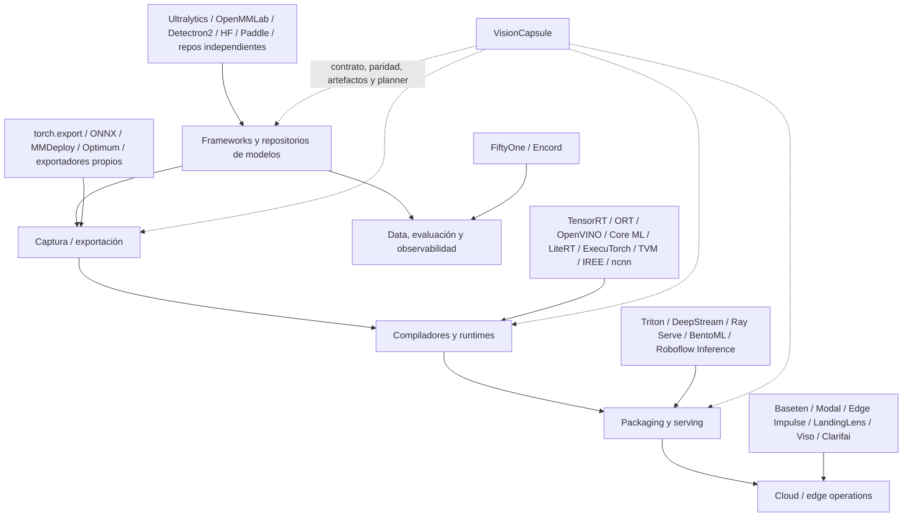
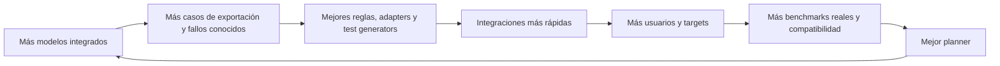
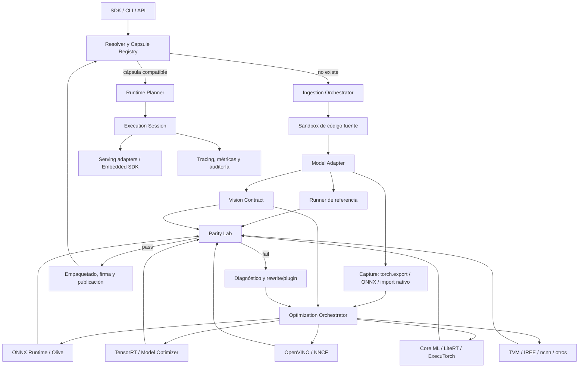
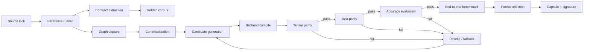
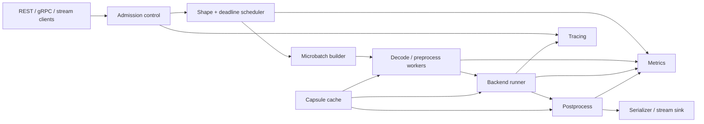
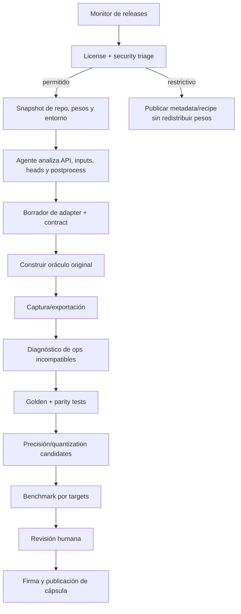
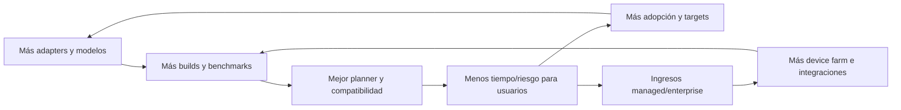

# Investigación técnica y de producto: construir la capa estándar de inferencia, optimización y deployment de Computer Vision

**Fecha de corte de la investigación:** 29 de julio de 2026
**Nombre de trabajo del producto:** **VisionCapsule**
**Documento de partida:** prompt de investigación proporcionado por el usuario.
**Estado:** recomendación estratégica, arquitectura propuesta y plan experimental; no se han ejecutado todavía benchmarks propios sobre hardware físico.

---

## Cómo leer este informe

Este documento separa cuatro clases de afirmaciones:

- **Hecho verificado:** respaldado por documentación oficial, repositorios originales o especificaciones primarias y acompañado por una referencia `[Sxx]`.
- **Estimación:** rango de esfuerzo, coste o plazo construido a partir de una descomposición de ingeniería; debe validarse con pilotos.
- **Hipótesis de producto:** supuesto que solo puede confirmarse mediante entrevistas, uso real o disposición a pagar.
- **Recomendación:** decisión derivada de los hechos, estimaciones y riesgos anteriores.

Las cifras de rendimiento publicadas por proveedores **no se comparan entre sí como si fueran homogéneas**. Cambian el modelo, la resolución, el batch, el hardware, la inclusión o no del preprocesamiento, el régimen térmico y la definición de latencia. Por ello, este informe no afirma que una solución sea globalmente más rápida que otra basándose en benchmarks de marketing.

---

# 1. Resumen ejecutivo

## 1.1 Respuesta inequívoca

**No deberíais construir un runtime de inferencia nuevo desde cero.** Tampoco deberíais lanzar únicamente un wrapper con una API bonita, un exportador ONNX genérico o un servidor más.

La oportunidad más defendible es construir una **capa neutral de compatibilidad, optimización, validación y distribución de artefactos de Computer Vision**, apoyada sobre runtimes existentes. Su unidad de valor no sería el checkpoint ni el engine por separado, sino una **Vision Capsule**: un paquete inmutable, firmado y verificable que contenga:

1. La referencia exacta al código y pesos originales.
2. La semántica completa de entradas, transformaciones geométricas, normalización, outputs, decoding y postprocesamiento.
3. Uno o varios grafos y artefactos optimizados para backends y hardware concretos.
4. La receta reproducible para reconstruirlos.
5. Un informe de paridad numérica y, sobre todo, de equivalencia a nivel de tarea.
6. La pérdida de accuracy medida en un dataset identificado y versionado.
7. Benchmarks end-to-end reproducibles, no solo tiempo de `forward`.
8. La matriz exacta de compatibilidad: arquitectura, sistema operativo, driver, runtime, acelerador, precisión y perfiles de shapes.
9. Provenance, licencia, hashes, SBOM y firma.
10. Una ruta de fallback segura cuando no exista un artefacto compatible.

La API de una línea sería solo la superficie:

```python
import visioncapsule as vc

model = vc.load(
    "roboflow/rf-detr-base",
    task="object-detection",
    device="auto",
    objective="latency",
    max_accuracy_drop=0.2,
)

result = model("image.jpg")
```

El valor real estaría en que esa línea selecciona un artefacto correcto, demuestra qué precisión conserva, reproduce exactamente el pipeline original y puede explicar por qué eligió un backend.

## 1.2 Por qué no un runtime nuevo

ONNX Runtime ya ofrece ejecución multiplataforma, optimizaciones de grafo y partición entre execution providers; TensorRT domina la optimización en NVIDIA; OpenVINO cubre especialmente bien el ecosistema Intel; Core ML, LiteRT y ExecuTorch son las rutas naturales para Apple, Android y edge PyTorch; TVM e IREE ya atacan el problema de compilación multiobjetivo; ncnn y MNN cubren despliegue ligero; Qualcomm AI Hub ya automatiza compilación, validación y profiling sobre dispositivos Qualcomm. [S06][S09][S11][S17][S18][S19][S20][S21][S22][S23][S24]

Competir con ellos implica construir y mantener operadores, planificadores de memoria, kernels, cuantización, toolchains, ABIs y soporte de hardware durante años. El coste es alto y la ventaja inicial sería baja. El proyecto sí puede desarrollar kernels propios más adelante, pero únicamente para cuellos de botella medidos y repetidos —por ejemplo, un decoder, NMS, resize o composición de máscaras—, no como punto de partida.

## 1.3 Por qué un wrapper o exportador tampoco basta

El listón competitivo ha subido:

- Ultralytics ya ofrece una API sencilla, múltiples tareas, exportación a numerosos formatos y, en 2026, extendió su infraestructura de exportación a módulos PyTorch arbitrarios además de sus propias familias. [S01][S02]
- Roboflow Inference es open source y ya integra serving, workflows, vídeo, preprocesamiento y postprocesamiento para numerosas arquitecturas. [S04][S05]
- MMDeploy empaqueta modelos OpenMMLab con metadata y SDK multilenguaje. [S32]
- Qualcomm AI Hub se acerca mucho a la experiencia “sube el modelo, compila, valida y perfila”, aunque limitada al ecosistema Qualcomm. [S24]
- NVIDIA TAO, TensorRT y DeepStream forman una cadena fuerte para modelos y pipelines NVIDIA. [S09][S30][S31]

Por tanto, `model(image)` no es una ventaja competitiva. **La ventaja debe ser la confianza reproducible y portable**: saber que el resultado sigue siendo correcto después de cambiar de framework, precisión, runtime, hardware o lenguaje.

## 1.4 Gap de mercado prioritario

La fragmentación más costosa no está en multiplicar matrices; está en la frontera entre el modelo y el producto:

- letterbox, redondeos y padding;
- RGB/BGR y layouts;
- normalización y dtype;
- convenciones de cajas y coordenadas;
- decoders específicos del head;
- NMS, top-k, thresholds y variantes end-to-end sin NMS;
- máscaras, keypoints y transformaciones de vuelta al espacio original;
- dynamic shapes y perfiles de compilación;
- operaciones no exportables o custom ops;
- calibración y capas sensibles a cuantización;
- incompatibilidades de versiones;
- divergencias silenciosas entre Python, C++, móvil y cloud.

Los propios issues de PyTorch, Ultralytics, Core ML Tools y Roboflow muestran casos recientes de NMS no exportable, operadores no soportados y resultados distintos por pre/postprocesamiento. Estos issues son evidencia cualitativa, no una estimación de prevalencia. [S56][S57][S58][S59]

## 1.5 Estrategia recomendada

Construir de forma escalonada una combinación de las estrategias **B + D + una versión acotada de E**:

- **B — frontend unificado:** SDK, CLI, contrato semántico y plugins de backend.
- **D — catálogo de artefactos:** cápsulas verificadas para modelos relevantes.
- **E — plataforma:** compilación gestionada, device farm, registry privado y CI de modelos, pero reutilizando runtimes existentes.

Aplazar:

- **C — IR/compilador propio:** hasta demostrar que ONNX, `torch.export` y los IR nativos bloquean optimizaciones recurrentes.
- **A — runtime propio:** descartado salvo que, a largo plazo, aparezca un nicho de hardware o pipeline que ningún runtime cubra.

## 1.6 Wedge inicial

El MVP debe empezar por **object detection en CPU x86 y NVIDIA GPU**, con:

- YOLO26, RF-DETR y RT-DETR como familias iniciales;
- referencia PyTorch;
- ONNX Runtime, TensorRT y OpenVINO;
- FP32, FP16 y un camino INT8 condicionado por accuracy;
- validación de paridad a nivel de detecciones y COCO mAP;
- benchmark end-to-end;
- CLI y SDK;
- cápsulas firmadas;
- exportación a Triton o servidor de referencia, sin construir un autoscaler propio.

## 1.7 Criterio de éxito del MVP

El MVP tendrá sentido si en 8–12 semanas demuestra simultáneamente:

- un modelo ya soportado produce un primer artefacto validado en menos de 60 minutos;
- una nueva arquitectura PyTorch convencional se integra en un día de ingeniería o menos;
- reduce al menos un 70% el código glue frente a una integración manual;
- conserva accuracy dentro del presupuesto declarado;
- queda a ≤10% de la latencia end-to-end de una integración experta nativa en al menos el 80% de la matriz seleccionada;
- tres organizaciones externas completan un piloto y al menos dos manifiestan disposición concreta a pagar por device farm, registry privado, soporte o SLA.

Si solo se valida la parte de corrección y no la selección automática de rendimiento, el producto debe pivotar a **“Parity and Artifact CI for Computer Vision”**, que sigue siendo una propuesta útil y más estrecha.

---

# 2. Definición exacta del producto

## 2.1 Qué es

VisionCapsule sería una plataforma compuesta por siete capas:

1. **Vision Contract:** especificación abierta y declarativa de la semántica del modelo y de la tarea.
2. **Adapter Sandbox:** adaptadores seguros para importar modelos de PyTorch, Ultralytics, Hugging Face, MMDetection, Paddle, ONNX y repositorios independientes.
3. **Artifact Builder:** captura, canonicalización, exportación y compilación hacia backends existentes.
4. **Parity Lab:** pruebas numéricas, geométricas, funcionales y de accuracy.
5. **Hardware Planner:** selección basada en restricciones y mediciones reales.
6. **Capsule Registry:** registro content-addressed de artefactos, recetas, compatibilidad, benchmarks, licencias y provenance.
7. **Runtime SDK y serving adapters:** carga, ejecución, observabilidad y despliegue sobre Triton, Ray Serve, BentoML, Kubernetes o un servidor de referencia.

## 2.2 Qué no es

En su versión 1, no debe ser:

- un framework de entrenamiento;
- una librería que reimplemente todas las arquitecturas;
- un nuevo formato tensorial equivalente a ONNX;
- un nuevo compilador de kernels generalista;
- un reemplazo de TensorRT, OpenVINO, Core ML o LiteRT;
- una plataforma de annotation/data management;
- un proveedor cloud genérico;
- un benchmark que solo mida `forward()`;
- un hub que redistribuya pesos sin respetar sus licencias.

## 2.3 Unidad de producto: la Vision Capsule

```text
capsule/
├── capsule.yaml
├── source/
│   ├── repository.lock
│   ├── weights.lock
│   └── license.json
├── contract/
│   ├── inputs.yaml
│   ├── preprocess.yaml
│   ├── outputs.yaml
│   ├── postprocess.yaml
│   └── labels.json
├── graphs/
│   ├── model.pt2
│   └── model.onnx
├── artifacts/
│   ├── onnxruntime-cpu/
│   ├── onnxruntime-cuda/
│   ├── tensorrt-sm89-fp16/
│   └── openvino-x86-int8/
├── recipes/
│   ├── capture.json
│   ├── quantization.json
│   └── build.json
├── validation/
│   ├── golden_inputs/
│   ├── tensor_parity.json
│   ├── task_parity.json
│   ├── accuracy.json
│   └── slices.json
├── benchmarks/
│   ├── environment.json
│   ├── end_to_end.json
│   └── traces/
└── provenance/
    ├── sbom.spdx.json
    ├── checksums.txt
    ├── signature.sig
    └── transparency.json
```

La cápsula debe poder contener binarios cuando sean realmente portables, pero también recetas reproducibles. En TensorRT y otros entornos dependientes del target, la receta y el fingerprint son tan importantes como el engine. NVIDIA documenta que los engines están ligados a condiciones de plataforma y versiones; por ello, el registry no debe fingir que un engine es universal. [S09][S31]

## 2.4 Posicionamiento

La frase de producto recomendada es:

> **“Build once, prove parity, deploy on the best available vision backend.”**

No:

> “El runtime más rápido para cualquier modelo.”

La primera promesa es verificable. La segunda es prácticamente imposible y os obliga a competir con cada fabricante en su mejor terreno.

---

# 3. Problema que resuelve

## 3.1 El pipeline de visión es parte del modelo

En Computer Vision, el checkpoint no define por sí solo la función desplegada. La predicción real es:

\[
\text{resultado} = P_{post}\left(M_{backend}\left(P_{pre}(x;\theta_{pre});\theta_M\right);\theta_{post}\right)
\]

Donde:

- `P_pre` incluye decoding de imagen, espacio de color, resize, letterbox, padding, normalización, layout, dtype y batch;
- `M_backend` puede cambiar de PyTorch a ONNX Runtime, TensorRT, OpenVINO, Core ML, etc.;
- `P_post` incluye decoding, sigmoid/softmax, transformación de coordenadas, clipping, top-k, NMS, masks, keypoints y serialización.

Una exportación puede conservar el grafo central y aun así cambiar la salida final por una diferencia de un píxel en padding, una convención `xywh` frente a `xyxy`, una transposición de outputs o un NMS distinto. El issue de Ultralytics de enero de 2026 sobre discrepancias entre Python y una implementación C++/OpenVINO ilustra precisamente esta frontera. [S56]

## 3.2 Fragmentación por capas

| Capa | Fragmentación habitual | Consecuencia |
|---|---|---|
| Fuente | repositorio propio, config Python/YAML, `state_dict`, checkpoint completo, remote code | instalación frágil y riesgo de supply chain |
| Entradas | PIL/OpenCV, RGB/BGR, NHWC/NCHW, uint8/float, rangos diferentes | resultados incorrectos sin error explícito |
| Geometría | resize directo, letterbox, center crop, stride alignment, rounding | cajas y máscaras desplazadas |
| Grafo | Python control flow, custom CUDA, torchvision ops, dynamic shapes | exportación fallida o especialización inesperada |
| Outputs | tensores por nivel, queries, logits, boxes normalizadas o absolutas | decoder específico por arquitectura |
| Postproceso | NMS, NMS-free, soft-NMS, top-k, class-aware, masks | divergencia funcional y de latencia |
| Cuantización | calibración, per-channel/per-tensor, Q/DQ, capas sensibles | caída de accuracy o ausencia de speedup |
| Backend | operadores, layouts y precisiones diferentes | una variante por target |
| Artefacto | engine dependiente de GPU/runtime/driver | falsa portabilidad |
| Serving | batching, streams, tracking, video decode, GPU sharing | latencia end-to-end distinta al benchmark |
| Evaluación | datasets, thresholds, warmup y medición heterogéneos | comparaciones no reproducibles |

## 3.3 Exportar no equivale a desplegar

PyTorch ha mejorado sustancialmente su ruta `torch.export` y su exportador ONNX, que capturan un grafo tensorial normalizado y constraints de shapes. Aun así, la propia documentación reconoce que programas no trazables requieren reescritura, metadata adicional o custom operators. [S13][S14]

ONNX especifica el grafo y versiona IR y opsets, pero no estandariza automáticamente la semántica completa de una tarea de visión ni obliga a dos aplicaciones a implementar el mismo letterbox o decoder. [S50]

Los ejemplos recientes de `torchvision::nms` sin descomposición ONNX y de `unfold` no soportado en una conversión Core ML evidencian que la cobertura de operadores continúa siendo una frontera práctica. [S57][S58]

## 3.4 Esfuerzo actual estimado

**Estimación a validar con 15–20 integraciones reales:**

| Tipo de modelo | Tiempo hasta primer resultado | Tiempo hasta artefacto productivo y validado |
|---|---:|---:|
| Familia ya soportada por el proveedor y target común | 15 min–4 h | 0.5–2 días |
| PyTorch convencional, ops estándar, pre/post claro | 0.5–2 días | 2–5 días |
| Detector independiente con decoder/NMS propio | 2–5 días | 1–3 semanas |
| Dynamic shapes complejos o multi-stage | 3–10 días | 2–5 semanas |
| Custom CUDA/C++ op, vídeo stateful o runtime edge poco documentado | 1–3 semanas | 3–8+ semanas |

Descomposición típica para el caso intermedio:

- reproducir el entorno y pesos: 0.5–2 días;
- obtener runner de referencia: 0.5–2 días;
- extraer pre/postprocesamiento exacto: 1–4 días;
- hacer exportable el grafo: 1–5 días;
- compilar y resolver el target: 1–5 días por familia de backend;
- diseñar paridad y dataset de validación: 2–5 días;
- calibrar y validar cuantización: 1–5 días;
- empaquetar, servir, observar y documentar: 2–10 días.

El producto debe reducir el trabajo repetible, no prometer automatizar mágicamente el 100% de los casos patológicos.

---

# 4. Mapa de competidores

## 4.1 Categorías

El mercado no contiene un único competidor; contiene capas parcialmente solapadas:



## 4.2 Competidores más cercanos

### Ultralytics

Fortalezas:

- experiencia de usuario excelente;
- familias de detección, segmentación, pose, clasificación y OBB;
- exportación a múltiples formatos;
- benchmark y autoselección básica de backend;
- enorme distribución.

Límite estratégico para este proyecto: su centro de gravedad sigue siendo su ecosistema de modelos y APIs. La ampliación de exportación a módulos PyTorch arbitrarios reduce mucho el valor de construir un exportador genérico, pero no convierte automáticamente a Ultralytics en un estándar neutral de evidencia de paridad, provenance y artefactos entre todos los frameworks. [S01][S02]

### Roboflow Inference

Es el competidor de producto más cercano porque combina integración de modelos, workflows, vídeo, pre/postprocesamiento y serving self-hosted o gestionado. [S04][S05]

La diferenciación frente a Roboflow no puede ser “también servimos modelos”. Debe ser:

- contrato abierto independiente del control plane;
- cápsulas portables y reproducibles;
- validación formalizada entre fuente y target;
- selección transparente de backends;
- recipes reconstruibles;
- registry usable on-prem sin depender de un workspace SaaS;
- benchmarking público y neutral.

Los issues abiertos de 2026 sobre bloqueo por carga de modelos e inconsistencias de RF-DETR muestran que incluso una plataforma madura sigue sufriendo en las fronteras de concurrencia y semántica de pre/postproceso. De nuevo, son ejemplos, no una medida de calidad global. [S59]

### Qualcomm AI Hub

Es un referente de experiencia: acepta modelos, compila, perfila y valida sobre dispositivos Qualcomm, y publica un catálogo amplio. [S24]

Es también una señal de que el concepto tiene valor comercial. Su límite es deliberado: Qualcomm. VisionCapsule debe ser horizontal y utilizar AI Hub como backend/plugin cuando el target sea Qualcomm, no intentar replicar su toolchain.

### NVIDIA TAO + TensorRT + DeepStream + Triton

Juntos resuelven entrenamiento/transfer learning, exportación, optimización, ejecución y vídeo a gran escala en el ecosistema NVIDIA. [S09][S29][S30][S31]

No hay una oportunidad razonable de superar TensorRT en optimización genérica NVIDIA desde un MVP. Sí existe oportunidad en:

- importar modelos externos;
- demostrar paridad;
- escoger configuraciones;
- empaquetar recipes y engines;
- comparar NVIDIA con CPU/Apple/Qualcomm;
- evitar que el usuario tenga que dominar cada herramienta.

### MMDeploy

Es una referencia importante para metadata, SDK y conversión de modelos OpenMMLab. Su alcance está muy ligado a las codebases y matrices de versiones de OpenMMLab. [S32]

La lección positiva es que el deployment necesita metadata de modelo y postprocesamiento; la oportunidad es generalizar ese concepto de forma estable y cross-framework.

### ONNX Runtime + Olive

ORT es el runtime horizontal más claro y Olive automatiza optimizaciones hardware-aware. [S06][S08]

No deben considerarse enemigos, sino el backend por defecto y un posible motor de optimización. El gap es que una herramienta de grafo general no conoce por sí sola si dos conjuntos de detecciones, máscaras o keypoints son equivalentes ni cuál es el pipeline exacto del repositorio original.

---

# 5. Matriz comparativa homogénea

Escala cualitativa: **Alta / Media / Baja / No central**. “Neutralidad” significa que la propuesta no está centrada en un fabricante, una familia de modelos o un SaaS específico.

## 5.1 Frameworks, runtimes y deployment

| Solución | Categoría principal | Cobertura de modelos | Hardware | Export/compilación | Cuantización | Serving | Neutralidad | Gap que deja |
|---|---|---|---|---|---|---|---|---|
| Ultralytics | framework + modelos + export | Alta en YOLO; creciente en PyTorch genérico | CPU, NVIDIA, Apple, móvil y otros vía formatos | Alta | Media/alta según backend | Básico/HUB | Media-baja | evidencia neutral de paridad y artifact contract [S01] |
| OpenMMLab + MMDeploy | model zoo + deployment | Alta dentro de OpenMMLab | múltiples backends | Alta | según backend | SDK | Media | dependencia de codebase/versiones; no universal [S32] |
| Detectron2 | framework de investigación | Media | principalmente PyTorch; export limitado | Media-baja | no central | no central | Alta | custom ops y deployment no son su foco [S33] |
| Hugging Face Transformers/timm | model hub + librerías | Muy alta en clasificación/transformers | depende del backend | Optimum/ONNX y terceros | terceros | Inference Providers | Media | task semantics y postproceso heterogéneos [S34] |
| PaddleDetection/FastDeploy | framework + deployment | Alta en ecosistema Paddle | ORT, TRT, OpenVINO, Paddle | Alta en sus modelos | Media | Paddle/FastDeploy | Media-baja | menor neutralidad y comunidad occidental [S35][S36] |
| ONNX Runtime | runtime | cualquier ONNX soportado | muy amplio por EPs | optimización de grafo, no ingestión completa | Alta | integrable | Alta | no captura por sí solo toda la tarea [S06][S07] |
| TensorRT | compiler/runtime NVIDIA | ONNX y APIs soportadas | NVIDIA | Excelente | Excelente en precisiones soportadas | vía Triton/DeepStream | Baja | vendor-specific; no resuelve source integration [S09] |
| OpenVINO + NNCF | compiler/runtime + optimización | amplio | Intel y CPU heterogénea | Alta | Alta | Model Server/otros | Media-baja | foco Intel; semántica de tarea externa [S11][S12] |
| `torch.compile` / AOTInductor | compilador PyTorch | PyTorch exportable | CPU/GPU soportado por PyTorch | Alta dentro de PyTorch | torchao/PT2E | integrable | Media | no es contrato cross-framework [S13][S15][S16] |
| ExecuTorch | runtime edge PyTorch | modelos exportables | móvil/edge mediante backends | Alta dentro de su flujo | backend-dependent | embebido | Media | no cubre cloud/otros frameworks [S17] |
| LiteRT | runtime edge | TF/PyTorch/JAX mediante conversión | Android/edge | Alta | Alta según target | embebido | Media-baja | ecosistema Google/Android; conversión específica [S18] |
| Core ML | runtime/formato Apple | modelos convertibles | Apple | Alta | Alta según compute unit | app-native | Baja | solo Apple; cobertura de ops variable [S19][S58] |
| TVM / IREE | compiler stack | grafos soportados | amplio | Muy alta y extensible | Media/alta | runtime propio | Alta | complejidad de adopción y mantenimiento [S20][S21] |
| ncnn / MNN | runtimes ligeros | modelos convertibles | CPU/Vulkan/móvil | Media/alta | Media | embebido | Alta | menor capa de producto, validation y registry [S22][S23] |
| Qualcomm AI Hub | cloud compiler + device farm | amplio, con catálogo | Qualcomm | Muy alta | Alta | SDKs target | Baja | solo Qualcomm [S24] |
| Roboflow Inference | inference platform | alta y creciente | cloud, CPU/GPU/edge | media/alta | según modelo/backend | Alta, incluido vídeo | Media-baja | neutralidad, attestation y recipes cross-vendor [S04][S05] |
| Triton | inference server | cualquier backend/model repo compatible | principalmente datacenter/NVIDIA, extensible | no central | backend-dependent | Excelente | Media | no integra/corrige modelos [S29] |
| Ray Serve / BentoML | serving framework | cualquiera que el usuario empaquete | cloud/cluster | no central | no central | Excelente | Alta | no resuelve conversión ni paridad [S41][S42] |
| Edge Impulse | plataforma edge | modelos dentro de su workflow | MCU/edge | EON compiler | Alta para edge | deployment artifacts | Baja | foco embedded y plataforma integrada |
| NVIDIA TAO/DeepStream | training/deploy/video | modelos TAO y compatibles | NVIDIA | Excelente | Alta | Excelente para vídeo | Baja | lock-in NVIDIA y familias soportadas [S30][S31] |

## 5.2 Plataformas adyacentes

| Solución | Valor principal | Por qué no es el mismo producto |
|---|---|---|
| FiftyOne | gestión de datasets, evaluación, visualización e interfaz común de modelos | puede ser integración del Parity Lab, pero no compila ni distribuye artefactos hardware-specific [S45] |
| Encord | curation, annotation, active learning y model evaluation | opera en el loop de datos/calidad, no en el compile/runtime contract [S46] |
| LandingLens | plataforma industrial de datos, training y deployment cloud/edge | solución vertical end-to-end con su propio workflow, no estándar neutral [S47] |
| Viso Suite | composición y operación de aplicaciones de visión enterprise | se centra en aplicaciones/fleet, no en artifact attestation cross-backend [S48] |
| Clarifai | model hub, workflows y compute orchestration | plataforma general gestionada; no contrato abierto de paridad [S49] |
| Baseten / Modal | hosting, packaging y autoscaling | ejecutan lo que se empaqueta; no resuelven por sí solos semántica CV ni equivalencia [S43][S44] |

## 5.3 Conclusión competitiva

No existe un vacío absoluto. Existen múltiples soluciones que cubren el 60–90% de un caso concreto. La oportunidad está en el **10–40% final que se repite entre combinaciones distintas** y que hoy se resuelve con scripts, conocimiento tácito y validación manual.

La plataforma ganará solo si hace ese tramo final:

- medible;
- reproducible;
- automatizable;
- portable;
- auditable;
- y suficientemente abierto para convertirse en estándar.

---

# 6. Gaps reales del mercado

## 6.1 Priorización

Puntuaciones de 1 a 5. Son una evaluación experta inicial y deben recalibrarse con datos de pilotos.

| Problema | Frecuencia | Gravedad | Impacto en rendimiento | Impacto en adopción | Dificultad de resolver | Potencial de diferenciación |
|---|---:|---:|---:|---:|---:|---:|
| Pre/postprocesamiento no especificado con precisión | 5 | 5 | 4 | 5 | 4 | 5 |
| Validación solo numérica, no a nivel de tarea | 5 | 5 | 2 | 5 | 4 | 5 |
| Custom ops / cobertura de exportación | 4 | 5 | 4 | 4 | 5 | 3 |
| Dynamic shapes y perfiles incorrectos | 4 | 4 | 5 | 4 | 4 | 4 |
| Quantización sin presupuesto de accuracy | 4 | 5 | 5 | 4 | 5 | 5 |
| Engines y ABIs no portables | 4 | 4 | 3 | 4 | 3 | 4 |
| Benchmark forward-only | 5 | 4 | 5 | 4 | 3 | 4 |
| Versiones y dependencias frágiles | 5 | 4 | 3 | 5 | 4 | 4 |
| Soporte lento de modelos nuevos | 4 | 3 | 2 | 4 | 4 | 5 |
| Edge heterogéneo | 5 | 5 | 5 | 5 | 5 | 5 |
| Seguridad/licencias de remote code | 3 | 5 | 1 | 4 | 4 | 4 |
| Vídeo y pipelines stateful | 3 | 5 | 5 | 4 | 5 | 4 |

## 6.2 Gaps comoditizados

No son buenos wedges aislados:

- una función `load()`;
- exportar un ResNet o YOLO estándar a ONNX;
- un servidor REST básico;
- medir FPS del `forward`;
- compilar un ONNX a TensorRT;
- aplicar INT8 con el toolkit del fabricante;
- descargar pesos desde Hugging Face.

Todos tienen múltiples alternativas maduras.

## 6.3 Gaps defendibles

### A. Contrato semántico ejecutable

No un README, sino una especificación machine-readable que pueda:

- generar pre/postprocesamiento en Python, C++, Rust, Swift, Kotlin o WebAssembly;
- comprobar invariantes;
- producir casos de prueba;
- describir transformaciones geométricas invertibles;
- declarar thresholds y política de NMS;
- versionarse sin ambigüedad.

### B. Parity as a product

La plataforma no marca un build como “correcto” porque el exportador terminó. Exige evidence gates y publica el resultado.

### C. Artifact recipes + compatibility

El usuario debe saber exactamente qué binario puede cargar y cuándo debe recompilar.

### D. Planner basado en medición

No basta con reglas como “NVIDIA → TensorRT”. Hay modelos pequeños donde el overhead, preprocesamiento o dynamic shapes cambian el resultado; el planner debe utilizar benchmarks del target y el SLO real.

### E. Day-one CI

Una combinación de agentes, plantillas, test generation, sandboxing y revisión humana puede reducir el tiempo de integración de modelos nuevos. La velocidad y la base de tests acumulada sí pueden crear un flywheel.

### F. Benchmark público de latencia end-to-end

MLPerf proporciona una base rigurosa de escenarios y accuracy, pero no pretende cubrir cada modelo moderno ni cada pre/postprocesamiento de repositorios independientes. VisionCapsule puede inspirarse en MLPerf y especializarse en reproducibilidad de modelos de visión de rápida evolución. [S40]


# 7. Usuarios objetivo

## 7.1 Beachhead recomendado

El usuario inicial no debe ser “cualquiera que use visión”. Debe ser un equipo que experimente dolor repetido al mover modelos entre repositorios y targets.

**ICP primario:** equipos de 3–30 ingenieros de ML/platform que despliegan detectores propios o de terceros en al menos dos combinaciones de hardware/runtime y que tienen requisitos explícitos de precisión, latencia o despliegue on-prem.

Ejemplos:

- robotics y automatización industrial;
- vídeo analytics y seguridad;
- retail analytics;
- logística e inspección;
- movilidad y sistemas embebidos;
- fabricantes de cámaras o appliances;
- vendors de software que soportan hardware heterogéneo;
- consultoras que repiten integraciones para clientes.

## 7.2 Dolor mínimo para cualificar

Un prospecto es atractivo si cumple al menos tres condiciones:

- soporta más de una familia de modelos;
- mantiene Python y C++/móvil/edge en paralelo;
- cambia de hardware o runtime según cliente;
- ha sufrido divergencias después de exportar;
- dedica ≥1 engineer-week por nueva combinación modelo-target;
- necesita documentar accuracy y reproducibilidad;
- mantiene imágenes Docker o matrices de versiones frágiles;
- tiene modelos privados o restricciones on-prem;
- necesita demostrar que INT8/FP16 no degrada una clase crítica.

## 7.3 Usuarios que no son el beachhead

- Investigador que solo ejecuta PyTorch en una GPU.
- Usuario satisfecho con una única familia Ultralytics.
- Empresa que utiliza únicamente una API cloud de visión.
- Equipo que entrena un solo clasificador para un único dispositivo.
- Aplicación móvil nativa que ya está completamente estandarizada en Core ML o LiteRT.

Esos usuarios pueden adoptar el SDK abierto, pero difícilmente justificarán el producto enterprise.

## 7.4 Jobs to be done

1. “Tengo un modelo nuevo; quiero saber si puede desplegarse en mi hardware sin leer todo el repositorio.”
2. “Quiero una variante más rápida dentro de un presupuesto de accuracy.”
3. “Necesito demostrar que la salida C++/edge equivale a la de investigación.”
4. “Quiero reproducir exactamente el artefacto dentro de seis meses.”
5. “Necesito elegir entre TensorRT, ORT, OpenVINO u otro backend con datos reales.”
6. “Quiero desplegar el mismo contrato en cloud, workstation y edge.”
7. “Quiero incorporar un modelo publicado esta semana, no dentro de dos meses.”

---

# 8. Propuesta de valor

## 8.1 Promesa principal

> **Convertir un repositorio de visión en artefactos de producción verificables para múltiples targets, con una sola especificación y evidencia automática de corrección.**

## 8.2 Beneficios medibles

| Beneficio | Métrica |
|---|---|
| Menos tiempo de integración | engineer-hours desde URL/checkpoint hasta artefacto validado |
| Menos código glue | LOC y módulos específicos eliminados |
| Menos regresiones silenciosas | fallos detectados por parity gates antes de release |
| Mejor decisión de backend | mejora frente a selección por regla estática |
| Reproducibilidad | porcentaje de builds reconstruibles desde recipe |
| Menos lock-in | número de backends que implementan el mismo contrato |
| Soporte rápido | tiempo entre release upstream y cápsula estable |
| Mejor operación | p50/p95/p99, memoria, energía y cold start publicados |

## 8.3 Funcionalidades diferenciales frente a comoditizadas

| Funcionalidad | Estado competitivo | Papel en el producto |
|---|---|---|
| API `load()` de una línea | comoditizada | necesaria, no moat |
| Exportación ONNX | comoditizada para casos estándar | backend interno |
| Compilación TensorRT/OpenVINO | resuelta por vendors | invocar, no reimplementar |
| REST/gRPC | comoditizada | adapter, no producto central |
| Contrato exacto de tarea | fragmentado | core abierto |
| Validación task-level cross-backend | parcialmente resuelta | core diferencial |
| Registry con recipes + evidence | poco estandarizado en CV | core diferencial |
| Hardware planner cross-vendor | fragmentado | diferencial progresivo |
| Day-one model CI | operativo y difícil de mantener | moat de ejecución |
| Device farm multi-vendor | costoso y valioso | monetización |
| Benchmark público end-to-end | insuficiente para modelos nuevos | distribución y confianza |

## 8.4 Flywheel potencial



Este flywheel solo existe si:

- los manifests y tests se reutilizan;
- los resultados se normalizan;
- la telemetría es opt-in y no filtra datos;
- la comunidad puede contribuir adapters;
- la empresa conserva valor comercial en device farm, private registry, soporte y datos agregados.

---

# 9. Arquitectura técnica

## 9.1 Vista general



## 9.2 Separación de control plane y data plane

### Control plane

- resolver modelos y revisiones;
- crear recipes;
- lanzar builds;
- coordinar device farm;
- registrar evidencia;
- políticas de licencia y seguridad;
- seleccionar artefactos;
- almacenar benchmarks.

### Data plane

- cargar una cápsula;
- ejecutar preprocesamiento;
- invocar el backend;
- ejecutar postprocesamiento;
- devolver un resultado tipado;
- emitir métricas.

El data plane debe poder funcionar offline y on-prem sin conexión al servicio cloud.

## 9.3 Vision Contract

La especificación debe describir el comportamiento, no únicamente los shapes.

```yaml
spec_version: "1.0.0"

model:
  id: "roboflow/rf-detr-base"
  revision: "git:4d3f..."
  task: "object-detection"
  architecture: "rf-detr"
  source_adapter: "rfdetr@1"
  weights:
    uri: "hf://..."
    sha256: "..."
  license:
    code: "Apache-2.0"
    weights: "model-specific"
    redistribution: "allowed"

inputs:
  - name: image
    media_type: image
    color_space: RGB
    tensor_layout: NCHW
    tensor_dtype: float32
    value_range: [0.0, 1.0]
    shape: [N, 3, H, W]
    constraints:
      N: {min: 1, max: 16}
      H: {allowed: [640, 800]}
      W: {allowed: [640, 800]}

preprocess:
  - op: decode_image
    backend: libjpeg-turbo
    exif_orientation: apply
  - op: letterbox
    target: [640, 640]
    interpolation: bilinear
    preserve_aspect_ratio: true
    stride_alignment: 32
    rounding: round_half_away_from_zero
    padding_distribution: symmetric_with_remainder_bottom_right
    padding_value: [114, 114, 114]
  - op: cast
    dtype: float32
  - op: scale
    factor: 0.00392156862745098
  - op: reorder
    from: HWC
    to: CHW

raw_outputs:
  - {name: boxes, dtype: float32, shape: [N, Q, 4]}
  - {name: logits, dtype: float32, shape: [N, Q, C]}

postprocess:
  - op: sigmoid
    input: logits
  - op: select_topk
    k: 300
    score_threshold: 0.001
  - op: boxes_convert
    from: cxcywh_normalized
    to: xyxy_input_pixels
  - op: invert_geometry
    trace: preprocess.geometry
  - op: clip_boxes
    domain: original_image
  - op: nms
    enabled: false

result_schema:
  type: detections
  boxes: xyxy
  coordinate_space: original_image_pixels
  class_ids: int64
  scores: float32

validation:
  reference_backend: pytorch
  task_metric:
    name: coco_map_50_95
    dataset: "coco-val2017@sha256:..."
  acceptance:
    fp32:
      max_map_drop_abs: 0.05
    fp16:
      max_map_drop_abs: 0.10
    int8:
      max_map_drop_abs: 0.50
  numerical:
    atol: 0.0001
    rtol: 0.001
```

Los thresholds anteriores son defaults propuestos, no leyes universales. Cada cápsula puede declarar criterios más estrictos o métricas de dominio.

## 9.4 Versionado

- `spec_version` con SemVer.
- **Major:** cambio incompatible en semántica o schema.
- **Minor:** nuevo campo/op opcional compatible.
- **Patch:** aclaración o bug sin cambio de comportamiento.
- Cada op declarativo tiene versión propia.
- Cada plugin custom está identificado por digest.
- Las migraciones son deterministas y generan un nuevo digest de contrato.
- El ID de cápsula es content-addressed sobre contrato, source locks, recipes y evidence.

## 9.5 Pre/postprocesamiento como DAG

Un simple listado lineal no basta para modelos multi-input, pyramids, prompts, masks o vídeo. Internamente debe utilizarse un DAG tipado:

- nodos puros siempre que sea posible;
- shapes y espacios de coordenadas como tipos;
- `TransformTrace` para invertir geometría;
- soporte de CPU/GPU placement;
- posibilidad de fusionar nodos;
- implementación de referencia y kernels opcionales;
- serialization independiente del lenguaje.

Ejemplo de tipos:

```text
Image[RGB,HWC,uint8,OriginalSpace]
  -> Image[RGB,HWC,uint8,LetterboxedSpace]
  -> Tensor[NCHW,float32,ModelInputSpace]
  -> RawDetections[ModelInputSpace]
  -> Detections[OriginalSpace,xyxy]
```

Esto elimina una clase completa de errores de coordenadas.

## 9.6 Backend plugins

Cada backend declara capacidades, no solo un nombre:

```yaml
backend: tensorrt
version: "11.1"
capabilities:
  devices: [nvidia-cuda]
  precisions: [fp32, fp16, bf16, fp8, int8, int4, fp4]
  dynamic_shapes: true
  max_profiles: 8
  custom_ops: plugin_registry
  preprocess_fusion: [resize, normalize, layout]
  postprocess_fusion: [nms]
  artifact_portability: target_fingerprinted
```

El planner nunca debe asumir que una precisión nominal implica kernels rápidos para todos los operadores. TensorRT, torchao, NNCF, AIMET y otros toolkits tienen coberturas distintas por operador y hardware. [S09][S12][S16][S27]

## 9.7 Componentes y responsabilidades

| Componente | Entrada | Salida | Responsabilidad | Riesgo principal |
|---|---|---|---|---|
| Resolver | model ID/revision | source lock | resolver sin ambigüedad | branch mutable |
| Sandbox | repo + policy | entorno aislado | ejecutar código no confiable | RCE/supply chain |
| Adapter | source model | reference runner + contract + capture | traducir framework | semántica tácita |
| Capture | runner/examples | graph(s) | eliminar Python cuando sea posible | graph breaks/custom ops |
| Optimizer | graph + constraints | candidates | generar variantes | explosión combinatoria |
| Backend | candidate + target | artifact | compilar/ejecutar/perfilar | versiones y ABI |
| Parity Lab | reference + candidate | evidence | demostrar corrección | métricas insuficientes |
| Registry | capsule | immutable object | storage, search y policies | licencias/binaries |
| Planner | request + hardware | execution plan | elegir variante | datos obsoletos |
| Runtime SDK | plan + input | typed result | ejecución consistente | overhead de abstracción |
| Serving adapter | session | endpoint/stream | producción | duplicar herramientas maduras |

---

# 10. Decisión: runtime propio frente a backends existentes

## 10.1 Comparación de estrategias

Puntuación 1 = favorable/bajo; 5 = desfavorable/alto, salvo “adopción” y “defensibilidad”, donde 5 es mejor.

| Estrategia | Dificultad | Capital | Tiempo a valor | Mantenimiento | Adopción potencial | Defensibilidad | Dependencia de terceros | Monetización | Decisión |
|---|---:|---:|---:|---:|---:|---:|---:|---:|---|
| A. Runtime nuevo | 5 | 5 | 5 | 5 | 2 | 4 si funciona | 2 | 3 | rechazar |
| B. Frontend unificado | 3 | 2 | 2 | 3 | 4 | 2 aislado | 4 | 3 | construir |
| C. Compilador/IR propio | 5 | 5 | 5 | 5 | 3 | 4 | 2 | 4 | aplazar |
| D. Catálogo de artefactos | 3 | 3 | 2 | 4 | 4 | 3 | 4 | 4 | wedge |
| E. Plataforma completa | 4 | 4 | 4 | 5 | 5 | 4 | 4 | 5 | construir por fases |

## 10.2 Recomendación

**Fase inicial:** B + D, con los componentes mínimos de E necesarios para automatizar builds y evidence.

**No construir una IR tensorial propia en v1.** Utilizar:

- `torch.export`/FX como captura para PyTorch;
- ONNX como formato de intercambio cuando el backend lo soporte;
- modelos ya nativos cuando proceda;
- IR y APIs nativas del backend para lowering;
- una **Semantic Vision IR** propia únicamente para pre/postprocesamiento, tipos de tarea, geometry trace, constraints y evidence.

## 10.3 Evaluación de IRs

| Opción | Ventaja | Limitación | Uso recomendado |
|---|---|---|---|
| `torch.export` | captura PyTorch AOT con constraints y grafo normalizado | solo PyTorch; programas no exportables requieren cambios | frontend PyTorch [S13] |
| ONNX | estándar estable, versionado y ampliamente soportado | cobertura de ops y semántica de tareas fuera del grafo | intercambio principal [S50] |
| StableHLO | compatibilidad explícita y ecosistema OpenXLA | menos natural para muchos repos PyTorch CV y postproceso | plugin futuro/JAX [S51] |
| MLIR | multi-level, dialectos y lowering muy extensibles | inversión enorme para diseñar/mantener dialecto y passes | largo plazo si hay necesidad probada [S52] |
| TVM Relax | optimización y targets heterogéneos | otra toolchain compleja; no elimina model semantics | backend plugin [S20] |
| IREE | compiler/runtime MLIR portable | cobertura e integración por modelo requieren ingeniería | backend plugin [S21] |
| IR propia completa | control total | coste y riesgo máximos | no antes de product-market fit |

## 10.4 Condición para reconsiderar una IR propia

Solo abrir ese proyecto si, tras al menos 50 modelos y 6 backends:

- ≥30% de los fallos requieren las mismas transformaciones no representables;
- el mismo set de optimizaciones se reimplementa tres o más veces;
- existe evidencia de ≥15% de speedup end-to-end no accesible mediante backends;
- dos fabricantes están dispuestos a colaborar;
- la empresa puede mantener un equipo compiler de 5–8 personas durante varios años.

---

# 11. Sistema de adaptadores

## 11.1 Principio

El adaptador no debe ser un wrapper de inferencia opaco. Debe producir cinco objetos explícitos:

1. `SourceDescriptor`.
2. `ReferenceSession`.
3. `VisionContract`.
4. `CapturedGraph` o diagnóstico de por qué no puede capturarse.
5. `EvaluationBundle` con datasets, labels y métricas.

## 11.2 Interfaz

```python
from __future__ import annotations
from abc import ABC, abstractmethod
from dataclasses import dataclass
from typing import Iterable, Mapping, Sequence

@dataclass(frozen=True)
class SupportReport:
    supported: bool
    confidence: float
    required_remote_code: bool
    blockers: tuple[str, ...]
    warnings: tuple[str, ...]

class ModelAdapter(ABC):
    @abstractmethod
    def probe(self, source: "ModelSource") -> SupportReport:
        """Inspecciona metadata sin ejecutar código no confiable."""

    @abstractmethod
    def resolve(self, source: "ModelSource") -> "SourceDescriptor":
        """Fija commit, pesos, hashes, licencia y dependencias."""

    @abstractmethod
    def load_reference(
        self,
        source: "SourceDescriptor",
        sandbox: "Sandbox",
    ) -> "ReferenceSession":
        """Crea el oracle de referencia dentro del sandbox."""

    @abstractmethod
    def infer_contract(
        self,
        session: "ReferenceSession",
        probes: Sequence["ProbeInput"],
    ) -> "ContractDraft":
        """Extrae candidatos; nunca publica sin revisión o tests."""

    @abstractmethod
    def capture(
        self,
        session: "ReferenceSession",
        contract: "VisionContract",
        examples: Sequence["ModelInput"],
    ) -> "CaptureReport":
        """Produce torch.export/ONNX/nativo y diagnostics."""

    @abstractmethod
    def reference_predict(
        self,
        session: "ReferenceSession",
        inputs: Sequence["RawInput"],
    ) -> Sequence["TaskResult"]:
        """Salida tipada de referencia para parity."""
```

## 11.3 Adaptadores iniciales

1. `UltralyticsAdapter`
2. `TorchModuleAdapter`
3. `HuggingFaceVisionAdapter`
4. `RFDETRAdapter`
5. `RTDETRAdapter`
6. `ONNXImportAdapter`

Después:

- MMDetection;
- torchvision;
- timm;
- PaddleDetection;
- Detectron2;
- SAM/SAM2;
- TensorFlow/JAX.

## 11.4 Adaptador genérico PyTorch

Debe aceptar tres niveles:

- **Nivel 0:** usuario aporta módulo, sample inputs y contract completo.
- **Nivel 1:** aporta módulo y task processor; la plataforma infiere shapes/graph.
- **Nivel 2:** aporta URL del repo; agente genera scaffolding y un humano aprueba.

No se debe prometer que un LLM entenderá correctamente cualquier repositorio sin test. El agente acelera extracción y generación de código; el Parity Lab decide.

## 11.5 Plugin de modelo personalizado

```python
class CustomDetectorAdapter(TorchModuleAdapter):
    MODEL_PATTERNS = ("CustomDetector",)

    def build_model(self, source, sandbox):
        cfg = sandbox.read_yaml("configs/infer.yaml")
        model = sandbox.import_symbol("src.model:create_model")(cfg)
        state = sandbox.safe_load_weights(source.weights)
        model.load_state_dict(state)
        return model.eval()

    def task_processor(self):
        return CustomDetectorProcessor(
            input_size=(640, 640),
            score_threshold=0.25,
        )
```

## 11.6 Rules de seguridad

- nunca ejecutar `setup.py`, notebooks o importaciones arbitrarias en el host;
- resolver commit immutable;
- bloquear red por defecto durante ejecución;
- filesystem de solo lectura salvo workspace temporal;
- límites de CPU, RAM, GPU y tiempo;
- `safetensors` preferido; pickle tratado como código;
- `trust_remote_code` requiere policy explícita, revisión y pin de commit;
- guardar logs y syscalls relevantes;
- escanear dependencias y generar SBOM;
- no publicar weights si la licencia no lo permite.

Hugging Face recomienda revisar y fijar revisions al usar remote code y proporciona scanning de modelos; PyTorch advierte de los riesgos de serialización basada en pickle. [S53][S55]

---

# 12. Pipeline de conversión y optimización

## 12.1 Flujo



## 12.2 Capture

Orden recomendado:

1. Ejecutar la referencia en eager y registrar inputs/outputs/intermedios elegidos.
2. Intentar `torch.export` en modo no estricto con shapes declarados.
3. Generar informe de graph breaks, guards y custom ops.
4. Exportar ONNX usando la ruta moderna basada en `torch.export`.
5. Verificar el ONNX con checker e inferencia de shapes.
6. Simplificar únicamente con passes que mantengan parity.
7. Conservar el grafo original y el transformado como objetos distintos.
8. Si un op no puede exportarse:
   - reescribirlo con ops estándar;
   - separarlo al task processor;
   - crear plugin backend;
   - o mantener una variante PyTorch fallback.

## 12.3 Canonicalización

Passes seguros de v1:

- constant folding;
- dead code elimination;
- eliminación de training-only nodes;
- batchnorm folding;
- fusión Conv+BN+activation cuando el backend no la realiza;
- canonicalización de layouts;
- normalización de casts redundantes;
- explicitación de outputs y nombres;
- shape constraints;
- separación opcional de postproceso.

No se debe duplicar una optimización que el backend ya aplica bien salvo que sea necesaria para portabilidad o diagnósticos.

## 12.4 Candidate generation

Para cada target:

```text
backend
× precisión
× shape policy
× batch size
× resolución
× inclusión de preprocesamiento
× inclusión de postprocesamiento
× perfiles de optimización
× configuración de threads/streams
```

El espacio completo es enorme. Se filtra en tres etapas:

### Etapa 1 — reglas de capacidad

Eliminar combinaciones no soportadas por modelo, op, target o memoria.

### Etapa 2 — estimación barata

- tamaño de artefacto;
- activation memory aproximada;
- compatibilidad de kernels;
- benchmark de subgrafos problemáticos;
- cache de modelos similares.

### Etapa 3 — medición real

Compilar y ejecutar solo candidatos prometedores en el target.

## 12.5 Algoritmo del optimizer

```python
class ModelOptimizer:
    def optimize(self, request: OptimizationRequest) -> OptimizationResult:
        contract = request.contract
        target = self.hardware.inspect(request.target)

        candidates = self.generate_candidates(contract, target, request.constraints)
        candidates = self.capability_filter(candidates)
        candidates = self.cost_model.rank(candidates)

        accepted = []
        for candidate in self.scheduler.select_budget(candidates):
            artifact = candidate.backend.compile(candidate)

            numerical = self.parity.tensor_check(
                reference=request.reference,
                candidate=artifact,
                corpus=request.golden_corpus,
            )
            if not numerical.accepted:
                continue

            task = self.parity.task_check(request.reference, artifact, contract)
            if not task.accepted:
                continue

            accuracy = self.evaluator.evaluate(artifact, request.eval_dataset)
            if not request.constraints.accept_accuracy(accuracy):
                continue

            perf = self.benchmarker.run_end_to_end(artifact, target, request.workload)
            if request.constraints.accept_performance(perf):
                accepted.append((artifact, accuracy, perf))

        return self.pareto.select(accepted, request.objective)
```

## 12.6 Método de búsqueda recomendado

### MVP

- reglas deterministas;
- grid pequeño;
- early stopping;
- cache por fingerprint;
- Pareto ranking.

### Meses 4–12

- Bayesian optimization multiobjetivo;
- multi-fidelity: microbench → subset → dataset completo;
- transfer learning del cost model entre modelos y hardware;
- bandits para priorizar candidatos.

### No recomendado inicialmente

Reinforcement learning. El entorno cambia con cada versión de runtime/driver, las recompensas son costosas y el espacio se puede recortar bien con capacidades y profiling. RL solo tendría sentido con miles de builds recurrentes y un simulador/cost model ya fiable.

## 12.7 Objetivo matemático

Ejemplo:

\[
\min_{c \in C} \; \alpha L_{p95}(c) + \beta E(c) + \gamma M(c) + \delta T_{build}(c)
\]

Sujeto a:

\[
\Delta Accuracy(c) \leq \epsilon,\quad
Memory(c) \leq M_{max},\quad
ColdStart(c) \leq S_{max},\quad
Compatible(c,target)=1
\]

El usuario puede optimizar latencia, throughput, energía, memoria, coste o una combinación.

## 12.8 Fusión de pre/postprocesamiento

Debe medirse porque puede ser un porcentaje relevante de la latencia para modelos pequeños.

Opciones:

- CPU/OpenCV de referencia;
- SIMD/libjpeg-turbo;
- CUDA kernels;
- NVIDIA DALI/DeepStream;
- OpenVINO preprocessing API;
- Core ML image inputs;
- LiteRT delegates;
- WebGPU shaders.

La regla es mantener una implementación semántica de referencia y permitir implementaciones aceleradas que pasen los mismos golden tests.


# 13. Cuantización y optimización dirigida por restricciones

## 13.1 Principio: no existe una precisión «mejor» en abstracto

La plataforma no debe traducir `precision="auto"` por «usa el menor número de bits disponible». Debe interpretarlo como:

> Encontrar la variante más eficiente que esté soportada de verdad por el hardware y el backend, y que cumpla una restricción de calidad medida a nivel de tarea.

Esto importa especialmente en visión. Muchos modelos combinan convoluciones, `matmul`, normalizaciones, interpolaciones, activaciones, ROI operations, generación de máscaras y NMS. Una variante INT4 puede reducir el tamaño de ciertos pesos sin acelerar el pipeline si:

- solo hay kernels INT4 eficientes para capas `Linear` y el modelo está dominado por convoluciones;
- las activaciones permanecen en FP16/FP32 y las conversiones añaden coste;
- el backend inserta cuantización/decuantización alrededor de muchos operadores;
- el modelo es tan pequeño que dominan decoding, resize, transferencias o postprocesamiento;
- la precisión obliga a conservar demasiadas capas en alta precisión;
- el target no tiene kernels o delegates adecuados.

TorchAO, TensorRT, OpenVINO/NNCF, AIMET, NVIDIA Model Optimizer y ONNX Runtime ofrecen superficies diferentes de cuantización y cobertura distinta de operadores; esa heterogeneidad es precisamente una razón para que el planner trabaje con capacidades declaradas y medición real, no con reglas universales. [S07] [S09] [S11] [S12] [S16] [S25] [S27]

## 13.2 Escalera de candidatos

La búsqueda debería avanzar de menor riesgo a mayor especialización:

1. **FP32 de referencia.** Oráculo de calidad y fallback.
2. **FP16 o BF16.** Primera opción en GPU/accelerators compatibles.
3. **INT8 estático.** Pesos y activaciones cuando el backend dispone de kernels end-to-end.
4. **INT8 dinámico o weight-only.** Solo si el grafo y target se benefician.
5. **FP8.** Para hardware y runtimes que lo soporten de forma efectiva.
6. **Mixed precision.** Capa, bloque u operador sensibles en mayor precisión.
7. **INT4.** Candidato condicional, no feature obligatoria.
8. **Sparsity estructurada.** Solo cuando exista soporte de kernel y validación de ganancia real.
9. **Cambios arquitectónicos o entrenamiento.** QAT, pruning o distillation quedan fuera del camino puramente de compilación.

La cápsula debe diferenciar con claridad:

- precisión nominal del artefacto;
- precisión de pesos;
- precisión de activaciones;
- acumulación;
- operadores que permanecen en otra precisión;
- formato de cuantización por tensor/per channel/per group;
- escala simétrica o asimétrica;
- backend que interpreta esa configuración.

## 13.3 PTQ primero; QAT como extensión separada

### Versión 1

La plataforma debe concentrarse en post-training quantization (PTQ):

- no modifica los pesos originales;
- tiene ciclo de integración corto;
- puede automatizarse y compararse entre backends;
- encaja con un producto de deployment.

### Versiones posteriores

QAT, distillation y pruning requieren dataset, entrenamiento, optimizador, checkpoints intermedios, recetas y una definición de propiedad del modelo distinta. Deben implementarse como un paquete opcional —por ejemplo, `visioncapsule.trainopt`—, no contaminar el núcleo de inferencia.

La frontera recomendada es:

```text
Core product:     capture → compile → PTQ → validate → benchmark → package
Optional product: fine-tune/QAT/prune/distill → hand result back to core
```

## 13.4 Calibration Contract

La calibración debe ser un activo versionado, no una carpeta opaca de imágenes. Ejemplo:

```yaml
calibration:
  dataset_ref: s3://private-bucket/calib/v3/
  manifest_sha256: "..."
  sample_count: 1024
  sampling:
    seed: 17
    strategy: stratified
    strata:
      - class_frequency
      - object_size
      - aspect_ratio
      - illumination
      - source_camera
  preprocessing_contract: sha256:...
  pii_policy: no_upload
  retention: ephemeral
```

Para detección, una muestra representativa debe preservar al menos:

- distribución de clases;
- objetos pequeños/medios/grandes;
- densidad de objetos;
- relación de aspecto;
- iluminación y dominio de cámara;
- resoluciones que aparecerán en producción;
- casos vacíos y escenas saturadas.

La plataforma puede ofrecer selección de calibración basada en embeddings o diversidad, pero debe mantener un baseline reproducible de muestreo estratificado. Los datos privados pueden quedarse en el entorno del usuario; el servicio remoto debería recibir estadísticas o artefactos intermedios únicamente cuando la política lo permita.

## 13.5 Análisis de sensibilidad

Antes de una búsqueda exhaustiva, el optimizer puede medir sensibilidad por bloque u operador:

1. cuantizar un subconjunto;
2. ejecutar un corpus pequeño;
3. medir divergencia tensorial y de tarea;
4. restaurar alta precisión en componentes sensibles;
5. construir candidatos mixed-precision.

Heurísticas iniciales razonables, pero no absolutas:

- conservar input stem y prediction heads en mayor precisión si muestran sensibilidad;
- evitar cuantizar normalizaciones o softmax cuando el backend no las fusiona de forma estable;
- evaluar por separado heads de clasificación, caja, máscara y keypoints;
- preservar operadores de geometría y postprocesamiento que no aportan ganancia cuantizados;
- preferir per-channel en convoluciones cuando esté soportado.

## 13.6 Búsqueda multiobjetivo

Ejemplo de API:

```python
optimized = vc.optimize(
    "capsule://org/model@1.2",
    target="jetson-orin-nx",
    workload={
        "batch": 1,
        "input_sizes": [[640, 640], [1280, 720]],
        "concurrency": 4,
    },
    constraints={
        "p95_ms": "<= 25",
        "peak_memory_mb": "<= 1200",
        "map_drop": "<= 0.5",
        "cold_start_ms": "<= 2000",
    },
    objective=["energy", "p95_ms"],
)
```

El flujo recomendado:

```text
capability pruning
        ↓
reglas y perfiles conocidos
        ↓
microbenchmark de operadores críticos
        ↓
subset de calibración/paridad
        ↓
dataset de evaluación
        ↓
benchmark end-to-end bajo carga
        ↓
frontera de Pareto + explicación
```

## 13.7 Cost model aprendido

Tras acumular ejecuciones, puede entrenarse un predictor de:

- compatibilidad;
- tiempo de build;
- latencia;
- memoria;
- probabilidad de superar la restricción de calidad.

Features posibles:

- histograma de operadores;
- shapes;
- bytes de parámetros y activaciones;
- intensidad aritmética aproximada;
- backend/runtime/driver;
- precision policy;
- target fingerprint;
- tamaño de batch y resolución;
- métricas de sensibilidad.

Su función inicial es **ordenar** candidatos, no sustituir la medición. Cada decisión publicada debe señalar si el dato procede de medición real, extrapolación o estimación.

## 13.8 Criterios de aceptación de una variante cuantizada

Una variante solo se publica como `verified` cuando:

- pasa los gates de integridad y semántica;
- cumple la caída máxima de la métrica de tarea;
- no introduce regresiones graves en slices relevantes;
- produce una mejora E2E estadísticamente significativa;
- no excede memoria/build time/cold start;
- es reproducible en un target equivalente;
- incluye receta y fingerprint completos.

Si INT8 reduce el artefacto, pero no mejora latencia, puede publicarse con objetivo `size`, no etiquetarse como `faster`.

---

# 14. Validación de paridad

## 14.1 La paridad es el producto central

Un exportador termina al generar un archivo. VisionCapsule debe terminar cuando puede demostrar:

1. qué comportamiento original se tomó como referencia;
2. qué transformaciones se aplicaron;
3. cuánto cambió el comportamiento;
4. en qué datos y hardware se midió;
5. si la variante cumple una política explícita.

Los problemas reportados en ecosistemas actuales —diferencias entre PyTorch, ONNX, OpenVINO o implementaciones C++, fallos al exportar NMS y operadores no soportados en Core ML— ilustran que «la conversión terminó» no implica equivalencia funcional. Son ejemplos, no una estimación de prevalencia. [S56] [S57] [S58] [S59]

## 14.2 Gates de validación

| Gate | Pregunta | Evidencia | Bloquea publicación |
|---|---|---|---:|
| G0 — integridad | ¿Son exactamente el código, pesos y dependencias declarados? | hashes, lockfiles, SBOM | Sí |
| G1 — input semantics | ¿El backend recibe el mismo tensor lógico? | golden preprocessing tests | Sí |
| G2 — tensor | ¿Outputs internos/finales están dentro de tolerancia? | abs/rel/ULP, cosine, histograms | Según política |
| G3 — task semantics | ¿Se producen las mismas entidades? | matching de boxes/masks/keypoints | Sí |
| G4 — accuracy | ¿Se mantiene la métrica en un dataset? | mAP, mIoU, OKS, etc. | Sí |
| G5 — slices | ¿Hay regresiones concentradas? | clase, tamaño, cámara, resolución | Sí para slices críticos |
| G6 — performance | ¿Existe la mejora prometida E2E? | benchmark firmado | Para claim de rendimiento |
| G7 — stability | ¿Es estable ante shapes, vacío y concurrencia? | fuzz/property/load tests | Sí |

## 14.3 Corpus de oro

Cada integración debe incluir un pequeño corpus de oro, versionado y redistribuible cuando la licencia lo permita:

- imágenes sintéticas para geometría;
- casos mínimos conocidos;
- resoluciones y aspect ratios extremos;
- imágenes sin detecciones;
- múltiples objetos y clases;
- inputs corruptos esperables;
- ejemplos del repositorio original;
- un subconjunto de evaluación con licencia clara.

Los golden files deben almacenar tanto inputs normalizados como resultados semánticos. Esto permite detectar por separado errores de decoding, letterbox, normalización o postprocesamiento.

## 14.4 Métricas tensoriales

Se recomienda guardar:

- error absoluto máximo y percentiles;
- error relativo;
- cosine similarity;
- KL/JS solo para distribuciones apropiadas;
- top-k agreement;
- rangos y saturación;
- localización de los primeros nodos divergentes;
- distribución del error por output/head.

La comparación exacta de logits no debe ser la única puerta: pequeñas diferencias numéricas pueden no afectar a la tarea, mientras que un error de escalado de cajas puede producir outputs tensorialmente plausibles y resultados semánticamente incorrectos.

## 14.5 Matching semántico por tarea

### Detección

1. filtrar con la misma política pre-NMS;
2. construir una matriz de coste por clase, IoU, centro y score;
3. emparejar con Hungarian o matching greedy documentado;
4. medir:
   - tasa de entidades emparejadas;
   - detecciones de alta confianza perdidas/añadidas;
   - error de coordenadas;
   - error de score;
   - class agreement;
   - IoU de pares;
   - diferencia tras NMS.

### Instance/semantic segmentation

- mIoU/Dice;
- boundary F-score;
- mask AP;
- áreas y componentes conectados;
- matching de instancias.

### Pose

- OKS;
- PCK;
- error por keypoint;
- visibilidad;
- skeleton validity.

### Clasificación

- top-1/top-5 agreement;
- accuracy;
- calibration error;
- margen de clase;
- slices por dominio.

### Depth

- AbsRel;
- RMSE;
- `δ1/δ2/δ3`;
- escala y shift cuando la tarea lo permita;
- discontinuidades/bordes.

### Optical flow

- endpoint error;
- outlier rate;
- consistencia temporal.

### Matting

- SAD;
- MSE;
- gradient/connectivity error.

## 14.6 Umbrales propuestos

Valores iniciales para el MVP —deben ser configurables y confirmados por dataset/modelo—:

| Variante | Caída global máxima sugerida | Regla adicional |
|---|---:|---|
| FP32 exportado | 0.05 mAP | ninguna pérdida de detección crítica |
| FP16/BF16 | 0.10 mAP | slices críticos dentro de 0.25 mAP |
| INT8 | 0.50 mAP | ninguna clase crítica pierde >1.0 AP |
| FP8/mixed | 0.50 mAP | saturación monitorizada |
| INT4 | definida por caso | nunca asumir equivalencia |

Para clasificación podrían expresarse en puntos porcentuales de top-1; para otras tareas, en su métrica principal. Además se necesita un umbral por muestra para impedir que una media aceptable esconda fallos severos.

## 14.7 Localización automática de divergencias

Cuando G2/G3 falla, el sistema debería ejecutar un modo de depuración:

```text
input bytes
 → decoded image
 → resized image
 → normalized tensor
 → selected graph checkpoints
 → raw heads
 → decoded candidates
 → filtered candidates
 → NMS
 → restored coordinates
```

Compara cada punto con el oráculo y devuelve la primera divergencia material. Para grafos grandes:

- insertar probes por bisección;
- mapear nombres entre grafo origen y destino;
- comparar subgrafos;
- detectar transpose/layout incorrecto;
- señalar casts y clamps añadidos;
- exportar un bundle mínimo reproducible.

## 14.8 Interfaz

```python
from dataclasses import dataclass
from typing import Protocol

@dataclass(frozen=True)
class ValidationPolicy:
    tensor_atol: float
    tensor_rtol: float
    task_thresholds: dict[str, float]
    metric_drop_max: float
    critical_slices: tuple[str, ...]

@dataclass(frozen=True)
class ParityReport:
    accepted: bool
    gate_results: dict[str, object]
    first_material_divergence: str | None
    metric_delta: dict[str, float]
    per_slice_delta: dict[str, dict[str, float]]
    evidence_uris: tuple[str, ...]

class ParityValidator(Protocol):
    def validate(
        self,
        reference: "RunnableModel",
        candidate: "RunnableArtifact",
        contract: "VisionContract",
        corpus: "ValidationCorpus",
        policy: ValidationPolicy,
    ) -> ParityReport:
        ...
```

## 14.9 Attestation

El resultado se firma junto a:

- digest del artefacto;
- digest del contrato;
- digest de dataset/manifest;
- versión del validador;
- versiones de dependencias;
- target fingerprint;
- política aplicada;
- fecha y actor de aprobación.

Esto convierte la paridad en una evidencia auditable, no en una captura de pantalla.

---

# 15. Serving

## 15.1 Construir un reference server, no competir con todos los servidores

Triton ya ofrece model repositories, múltiples backends y dynamic batching; Ray Serve y BentoML ofrecen composición, batching, despliegue y escalado; DeepStream está especializado en pipelines de vídeo NVIDIA. [S29] [S30] [S41] [S42]

Por tanto, el proyecto debe:

- incluir un servidor de referencia sencillo;
- publicar generadores/adaptadores para Triton, Ray Serve, BentoML y DeepStream;
- mantener el contrato de resultados y observabilidad;
- no construir de inicio un scheduler distribuido, autoscaler o control plane de Kubernetes.

## 15.2 Qué ideas de serving de LLM se transfieren

Sí se transfieren:

- colas y admission control;
- dynamic batching;
- priorización/deadlines;
- warm pools;
- model multiplexing;
- observabilidad por fase;
- backpressure;
- GPU sharing;
- aislamiento multi-tenant;
- cache de artefactos.

No se transfieren de forma directa:

- KV cache;
- paged attention;
- token-by-token decoding;
- prefill/decode disaggregation;
- continuous batching entendido como incorporación y salida de secuencias en cada token.

La mayoría de modelos de visión feed-forward ejecuta uno o pocos forwards por request. La unidad de scheduling es una imagen/frame, no un token. Para vídeo, el equivalente útil es **microbatching por deadline y stream**, con afinidad para estado de tracking o memoria temporal.

## 15.3 Modos de workload

### Imágenes síncronas

- batch 1;
- prioridad de latencia;
- respuesta JSON/binaria.

### API concurrente

- dynamic batching con ventana máxima;
- buckets por shape;
- límites de memoria;
- p95/p99 como objetivo.

### Offline

- batch grande;
- pipeline asíncrono de decode, H2D, compute y write;
- objetivo throughput/energía.

### Vídeo multi-stream

- frame queues por stream;
- timestamp y deadline;
- drop policy explícita;
- batching inter-stream;
- session affinity;
- tracker/state store;
- métricas de frames perdidos y lag.

### Pipelines compuestos

- detector → crop → classifier/OCR;
- segmenter → downstream geometry;
- ensemble/cascade;
- DAG con condiciones.

Triton ensembles o herramientas existentes pueden ejecutar parte de estos flujos; VisionCapsule debe generar la configuración y conservar la semántica. [S29]

## 15.4 Arquitectura del reference server



## 15.5 Interfaces

```python
class TaskProcessor(Protocol):
    task: str

    def decode_input(self, request: "InferenceRequest") -> "MediaBatch": ...
    def preprocess(self, media: "MediaBatch", contract: "VisionContract") -> "TensorBatch": ...
    def decode_outputs(self, outputs: "TensorMap", context: "GeometryContext") -> "TaskResult": ...
    def serialize(self, result: "TaskResult", format: str) -> bytes: ...


class ExecutionBackend(Protocol):
    backend_id: str

    def inspect_target(self) -> "TargetCapabilities": ...
    def supports(self, artifact: "ArtifactSpec", workload: "Workload") -> "SupportReport": ...
    def load(self, artifact: "ArtifactSpec", options: dict) -> "ModelHandle": ...
    def warmup(self, handle: "ModelHandle", profiles: list["ShapeProfile"]) -> None: ...
    def run(self, handle: "ModelHandle", batch: "TensorBatch") -> "TensorMap": ...
    def close(self, handle: "ModelHandle") -> None: ...
```

## 15.6 Optimizaciones de data path

- decoders eficientes y reutilización de buffers;
- pinned memory para H2D;
- streams asíncronos;
- zero-copy cuando sea viable;
- pre/postprocesamiento en GPU solo si reduce E2E;
- CUDA Graphs para perfiles estáticos;
- memory pools;
- shape buckets;
- serialización binaria opcional;
- JPEG decode por hardware cuando exista;
- evitar copiar masks completas si el cliente solo requiere polígonos/RLE.

## 15.7 Observabilidad

Métricas mínimas:

- queue time;
- decode;
- preprocess;
- H2D/D2H;
- backend execution;
- postprocess/NMS;
- serialization;
- latency p50/p95/p99;
- batch size efectivo;
- utilización y memoria;
- frames dropped/late;
- cache hit;
- errores por capsule/backend;
- drift del input cuando se habilite.

Cada respuesta debe incluir opcionalmente:

```json
{
  "model": "org/model@1.2",
  "capsule_digest": "sha256:...",
  "artifact_digest": "sha256:...",
  "backend": "tensorrt-11.1",
  "target_profile": "sm_89-cuda_13.0",
  "request_id": "..."
}
```

## 15.8 Serving API

```bash
vc serve capsule://org/model@1.2 \
  --target auto \
  --objective p95 \
  --max-batch 16 \
  --batch-window 3ms \
  --grpc 9000 \
  --http 8080
```

```bash
vc export-serving capsule://org/model@1.2 \
  --target triton \
  --output ./model-repository
```

---

# 16. Soporte de modelos desde el día uno

## 16.1 Objetivo realista

«Día uno» no debe significar que todos los modelos reciben todos los backends en 24 horas. Debe significar:

- detección y triage inmediatos;
- una integración de referencia auditable muy rápida;
- artefactos solo para targets que pasen validación;
- estado público y explicaciones de bloqueos;
- SLA distinto según complejidad/licencia.

## 16.2 Pipeline operativo



## 16.3 Qué automatizar con agentes

| Actividad | Automatización estimada tras madurar | Revisión humana |
|---|---:|---|
| Descubrir releases | 90–100% | priorización |
| Extraer metadata/licencia inicial | 70–90% | decisión legal |
| Reconstruir entorno | 60–80% | dependencias conflictivas |
| Generar skeleton de adapter | 70–90% | contrato público |
| Inferir preprocessing | 60–80% | geometría/casos límite |
| Inferir postprocessing | 40–70% | alta |
| Crear golden tests | 70–90% | selección de casos |
| Exportar modelo estándar | 70–90% | bloqueos de tracing |
| Resolver custom ops | 20–50% | casi siempre |
| Ejecutar parity/bench | >90% | revisar anomalías |
| Publicar y firmar | automatizable | aprobación obligatoria |

Estas cifras son **hipótesis de planificación**, no datos observados. Deben reemplazarse por métricas internas después de las primeras 20 integraciones.

## 16.4 Límites del uso de LLMs/agentes

Un agente puede:

- localizar el entry point;
- identificar transformaciones;
- generar código de adapter;
- proponer export patches;
- escribir tests;
- clasificar errores conocidos;
- redactar documentación.

No puede ser la fuente de verdad para:

- semántica geométrica;
- licencia;
- seguridad de código remoto;
- equivalencia de outputs;
- precisión;
- compatibilidad de un engine;
- aprobación de publicación.

Todo output generado debe probarse contra el oráculo y ejecutarse en sandbox sin credenciales.

## 16.5 SLA propuesto

| Clase de modelo | Ejemplo de características | SLA de referencia verificada | Targets optimizados |
|---|---|---:|---:|
| Catálogo conocido | variante de una familia ya soportada | 2–6 h | 6–24 h |
| Hugging Face/timm/torchvision convencional | ops estándar, config declarativa | 6–24 h | 1–2 días |
| PyTorch convencional nuevo | preprocessing/postprocess Python | 1–3 días laborables | 2–5 días |
| Postprocess complejo | masks, queries, multi-stage | 3–7 días | 1–2 semanas |
| Custom CUDA/C++ ops | extensión no portable | 1–3 semanas | por target |
| Modelo temporal/multimodal complejo | estado, vídeo, prompts | 1–3 semanas | por backend |
| Licencia restrictiva | no redistribución | metadata/recipe en 24 h | build local del usuario |

## 16.6 CI/CD por modelo

Cada PR de integración ejecuta:

1. lint/schema validation;
2. escaneo de licencia y secretos;
3. entorno sandbox;
4. unit/golden tests CPU;
5. capture/export;
6. parity rápida;
7. build de candidatos permitidos;
8. accuracy en subset;
9. nightly dataset completo;
10. benchmark en device farm;
11. generación de model card;
12. SBOM, firma y provenance;
13. publicación canary;
14. promoción tras política.

## 16.7 Estados públicos

- `discovered`;
- `triaged`;
- `reference-ready`;
- `exportable`;
- `verified:<backend>`;
- `optimized:<target>`;
- `blocked:license`;
- `blocked:custom-op`;
- `deprecated`;
- `revoked`.

Mostrar el bloqueo crea confianza y evita que «soportado» signifique simplemente «aparece en una lista».

---

# 17. Benchmark público y reproducible

## 17.1 Principio

El benchmark no debe intentar demostrar que la capa universal «vence a TensorRT» en un kernel que TensorRT ejecuta. Debe medir dos promesas distintas:

1. **Performance:** alcanzar un resultado cercano al mejor backend nativo experto para el target.
2. **Productividad/confianza:** llegar a ese resultado con menos trabajo, manteniendo semántica, precisión y reproducibilidad.

TensorRT incluye `trtexec` para medición y MLPerf Inference proporciona prácticas y escenarios estandarizados; el proyecto debe apoyarse en ellos cuando corresponda, pero añadir la cadena E2E de visión y el coste de integración. [S10] [S40]

## 17.2 Métricas end-to-end obligatorias

Para cada request:

```text
T_total = T_read/decode
        + T_resize/normalize
        + T_host_to_device
        + T_queue
        + T_forward
        + T_device_to_host
        + T_decode_head
        + T_NMS/postprocess
        + T_serialize
```

Reportar:

- p50, p95 y p99;
- throughput sostenido;
- cold start;
- warmup;
- tiempo de build/compilación;
- peak RSS y memoria de dispositivo;
- uso CPU/GPU;
- tamaño del artefacto;
- energía por imagen cuando haya instrumento fiable;
- precisión y delta;
- effective batch size;
- tasa de errores/dropped frames;
- líneas de glue code;
- engineer-hours de integración.

El forward-only se conserva como métrica diagnóstica, claramente separado.

## 17.3 Escenarios

| Escenario | Configuración | Métrica primaria |
|---|---|---|
| Single-stream | batch 1, sin concurrencia | p50/p95 |
| Server latency | concurrencia creciente | p95/p99 + QPS |
| Offline throughput | batch óptimo | imágenes/s |
| Multi-stream vídeo | N streams y deadlines | FPS útil + drop/lag |
| Cold deployment | cache vacío | time-to-first-result |
| Build | entorno limpio | tiempo y tasa de éxito |
| Constrained edge | memoria/energía limitadas | p95 + joules/image |
| Dynamic shapes | conjunto de resoluciones | p95 por bucket |

## 17.4 Hardware

### Banco inicial

- NVIDIA datacenter: L4 o equivalente accesible;
- NVIDIA consumo: RTX 4090 o generación vigente comparable;
- Intel x86 CPU;
- AMD x86 CPU;
- Jetson Orin;
- Apple Silicon.

### Expansión

- H100/B200-class para throughput;
- Raspberry Pi 5 cuando el modelo sea viable;
- Android Qualcomm;
- iPhone/ANE;
- WebGPU;
- aceleradores edge especializados mediante partners.

No es necesario poseer todo el hardware: una combinación de laboratorio, CI de fabricantes y device farms es más eficiente. Qualcomm AI Hub ya demuestra el valor de compilar y perfilar sobre dispositivos reales, aunque sea una solución específica de su ecosistema. [S24]

## 17.5 Model suite

### MVP: detección

- YOLO26 n/s/m;
- RF-DETR nano/small/base;
- RT-DETR/RT-DETRv2 o RT-DETRv4 representativo;
- un detector externo no diseñado por el equipo, reservado como prueba ciega.

YOLO26, RF-DETR y la familia RT-DETR cubren patrones distintos de head, postprocessing y arquitectura, lo que reduce el riesgo de construir solo para un repositorio. [S02] [S37] [S38]

### Expansión por tarea

- clasificación: ResNet, ConvNeXt, ViT/timm;
- segmentation: SegFormer/DeepLab y instance segmentation;
- promptable segmentation: SAM 2;
- pose;
- depth;
- optical flow;
- matting;
- encoder visual multimodal.

SAM 2 y su componente temporal deben considerarse una clase avanzada, no prometerse en el primer MVP. [S39]

## 17.6 Baselines obligatorios

Siempre que soporten exactamente el mismo modelo:

- repositorio PyTorch original;
- `torch.compile`;
- Ultralytics;
- ONNX Runtime;
- TensorRT;
- OpenVINO;
- Roboflow Inference;
- backend/vendor-specific relevante.

No comparar un modelo distinto con el mismo nombre comercial sin declarar pesos, resolución, threshold y postprocessing.

## 17.7 Protocolo

1. fijar clocks/power mode cuando el hardware lo permita;
2. registrar temperatura y throttling;
3. entorno limpio y versiones bloqueadas;
4. warmup explícito;
5. al menos tres repeticiones de cada experimento;
6. suficiente número de requests para percentiles estables;
7. orden aleatorio o intercalado para reducir sesgo térmico;
8. intervalos de confianza/bootstrap;
9. misma entrada decodificada y mismo contrato;
10. verificar accuracy antes de aceptar performance;
11. publicar logs crudos y scripts;
12. separar build time de runtime;
13. registrar fallos, no solo configuraciones exitosas.

## 17.8 Productivity benchmark

La comparación de producto debe incluir tareas ciegas realizadas por ingenieros:

- integrar un modelo nuevo;
- desplegarlo en dos targets;
- detectar una regresión de letterbox;
- producir una variante INT8;
- reproducir el artefacto 30 días después.

Métricas:

- tiempo activo;
- tiempo total;
- número de comandos;
- líneas de código específico;
- tasa de éxito;
- incidencias silenciosas no detectadas;
- facilidad de diagnóstico;
- artefactos reproducibles.

## 17.9 Criterio de éxito de rendimiento

Objetivo razonable para 12 meses:

- estar dentro de **5% de la mejor latencia E2E nativa** en al menos 80% de las configuraciones oficialmente soportadas;
- superar la implementación original no optimizada en ≥20% en un porcentaje significativo de targets;
- no añadir >2% de overhead propio fuera de pre/postprocesamiento declarado;
- producir la configuración en una fracción del tiempo experto.

Estos valores son objetivos de producto, no resultados ya demostrados.


# 18. MVP de 8–12 semanas

## 18.1 Hipótesis que debe probar

El MVP no debe intentar probar que se puede soportar toda Computer Vision. Debe responder cuatro preguntas:

1. ¿Un contrato semántico evita una parte material de los errores y glue code?
2. ¿La misma cápsula puede producir variantes fiables para varios backends?
3. ¿La validación automatizada detecta regresiones que los usuarios sufren hoy?
4. ¿Los equipos pagan por ahorrar integración, validación y mantenimiento?

## 18.2 Alcance recomendado

### Incluido

- tarea GA: object detection;
- familias: YOLO26, RF-DETR y RT-DETR;
- 8–10 checkpoints totales;
- origen: PyTorch/Ultralytics/repositorio independiente;
- backends: PyTorch de referencia, ONNX Runtime, TensorRT y OpenVINO;
- targets: x86 CPU y NVIDIA GPU;
- precisiones: FP32, FP16; INT8 en al menos dos modelos/targets si aporta ganancia;
- Vision Contract v0.1;
- cápsula local firmable;
- golden tests y parity gates;
- benchmark E2E;
- CLI y SDK Python;
- registry local/OCI básico;
- reference server REST/gRPC básico;
- exportador de configuración Triton como stretch goal.

### Fuera de alcance

- runtime de operadores propio;
- IR de cómputo propia;
- entrenamiento/QAT/distillation;
- Core ML, LiteRT, ExecuTorch y QNN;
- WebGPU;
- autoscaling/Kubernetes control plane;
- editor gráfico;
- marketplace;
- todas las tareas;
- custom CUDA ops arbitrarios;
- garantía de «day-one» pública.

## 18.3 Deliverable demostrador

El demo debe ejecutar:

```bash
# 1. Inspeccionar el repositorio/modelo y crear el contrato
vc inspect ultralytics/yolo26s --task detection --out yolo26s/

# 2. Construir artefactos para el equipo actual
vc build yolo26s/ \
  --targets pytorch,onnxruntime,tensorrt,openvino \
  --precisions fp32,fp16,int8 \
  --objective latency

# 3. Validar contra el oráculo
vc validate yolo26s/ --dataset coco-val-subset.yaml

# 4. Medir toda la cadena
vc bench yolo26s/ --scenario single-stream --json results.json

# 5. Empaquetar y firmar
vc package yolo26s/ --sign --out yolo26s.vcap

# 6. Ejecutar con selección automática
vc run yolo26s.vcap image.jpg --device auto --explain

# 7. Servir
vc serve yolo26s.vcap --http 8080 --grpc 9000
```

Salida de `--explain`:

```text
Selected: TensorRT FP16 / profile 640x640 / SM 89
Reason:
  - compatible with driver/runtime fingerprint
  - validation: PASS, ΔmAP = -0.04
  - measured p95: 5.8 ms on matching target
  - 21% faster E2E than ONNX Runtime CUDA
Rejected:
  - TensorRT INT8: ΔmAP -0.73 > policy -0.50
  - OpenVINO FP16: target lacks compatible device plugin
Fallback:
  - ONNX Runtime CUDA FP16
```

## 18.4 Arquitectura del repositorio

```text
visioncapsule/
├── pyproject.toml
├── packages/
│   ├── vc-core/
│   │   ├── visioncapsule/
│   │   │   ├── contract/
│   │   │   │   ├── schema.py
│   │   │   │   ├── geometry.py
│   │   │   │   ├── preprocessing.py
│   │   │   │   └── postprocessing.py
│   │   │   ├── model.py
│   │   │   ├── task.py
│   │   │   ├── result.py
│   │   │   └── fingerprints.py
│   ├── vc-adapters/
│   │   ├── ultralytics/
│   │   ├── rfdetr/
│   │   ├── rtdetr/
│   │   ├── huggingface/
│   │   └── pytorch_generic/
│   ├── vc-capture/
│   │   ├── torch_export/
│   │   ├── onnx/
│   │   └── diagnostics/
│   ├── vc-backends/
│   │   ├── pytorch/
│   │   ├── onnxruntime/
│   │   ├── tensorrt/
│   │   └── openvino/
│   ├── vc-optimize/
│   │   ├── capabilities/
│   │   ├── candidates/
│   │   ├── quantization/
│   │   ├── search/
│   │   └── pareto.py
│   ├── vc-validation/
│   │   ├── golden/
│   │   ├── tensors/
│   │   ├── detection/
│   │   ├── metrics/
│   │   └── reports/
│   ├── vc-benchmark/
│   │   ├── phases/
│   │   ├── scenarios/
│   │   ├── telemetry/
│   │   └── reports/
│   ├── vc-capsule/
│   │   ├── manifest.py
│   │   ├── package.py
│   │   ├── sbom.py
│   │   ├── signing.py
│   │   └── registry.py
│   ├── vc-runtime/
│   │   ├── planner.py
│   │   ├── loader.py
│   │   ├── fallback.py
│   │   └── explain.py
│   ├── vc-serving/
│   │   ├── scheduler.py
│   │   ├── server.py
│   │   ├── rest.py
│   │   ├── grpc.py
│   │   └── triton_export.py
│   └── vc-cli/
├── specs/
│   ├── vision-contract.schema.json
│   ├── capsule-manifest.schema.json
│   └── compatibility.schema.json
├── models/
│   ├── yolo26/
│   ├── rfdetr/
│   └── rtdetr/
├── tests/
│   ├── unit/
│   ├── property/
│   ├── golden/
│   ├── parity/
│   ├── integration/
│   ├── performance/
│   └── security/
├── benchmarks/
├── examples/
└── docs/
```

## 18.5 Responsabilidad de componentes

| Componente | Entrada | Salida | Dependencias clave | Tests críticos |
|---|---|---|---|---|
| `contract` | metadata/model adapter | DAG semántico versionado | Pydantic/JSON Schema | round-trip, invariants, migrations |
| `adapters` | repo/checkpoint | oráculo + contract draft | frameworks origen | golden outputs, source pin |
| `capture` | módulo + example inputs | ExportedProgram/ONNX | PyTorch/ONNX | dynamic shapes, unsupported ops |
| `backends` | artifact spec | runnable handle | vendor runtimes | capability, lifecycle, errors |
| `optimize` | graph/contract/target | candidates | quant toolkits | deterministic recipes, pruning |
| `validation` | reference/candidate/corpus | attestation | task metrics | known injected regressions |
| `benchmark` | runnable/workload | signed measurements | telemetry | phase accounting, variance |
| `capsule` | artifacts/evidence | `.vcap`/OCI layout | Sigstore/OCI | digest, tamper, reproducibility |
| `runtime` | capsule + host | selected artifact | capability probes | fallback/explanation |
| `serving` | capsule + requests | task responses | FastAPI/gRPC initially | batching, concurrency, deadlines |

## 18.6 Modelo de capsule en disco

```text
model.vcap/
├── capsule.yaml
├── contract/
│   ├── vision-contract.yaml
│   └── schema-version.txt
├── source/
│   ├── source-lock.json
│   ├── weights.lock
│   └── licenses/
├── artifacts/
│   ├── pytorch-fp32/
│   ├── ort-cpu-fp32/
│   ├── ort-cuda-fp16/
│   ├── trt-sm89-fp16/
│   └── openvino-x86-int8/
├── recipes/
├── calibration/
│   └── manifest.json
├── evidence/
│   ├── parity/
│   ├── accuracy/
│   └── benchmarks/
├── security/
│   ├── sbom.spdx.json
│   ├── provenance.intoto.jsonl
│   └── signatures/
└── docs/
    ├── model-card.md
    └── known-limitations.md
```

La cápsula puede representarse como directorio local, tar determinista u OCI artifact. No es necesario inventar un contenedor nuevo para distribución.

## 18.7 Tests

### Unitarios

- transforms;
- geometría de cajas/máscaras;
- schema;
- fingerprints;
- matching;
- candidate filtering.

### Property-based

- resize/letterbox seguido de inverse mapping;
- conversiones `xyxy`, `xywh`, `cxcywh`;
- clips y coordenadas normalizadas;
- NMS invariants;
- serialización round-trip;
- shape profiles.

### Golden

- preprocessing byte/tensor exacto;
- raw heads de oráculo;
- postprocessing;
- casos extremos.

### Integration

- build limpio por backend;
- carga/descarga repetida;
- fallback;
- concurrencia;
- error messages.

### Regression/performance

- umbrales relativos, no tiempos absolutos en CI compartido;
- runners dedicados para release;
- alertas sin bloquear PR hasta confirmar repetición.

### Security

- checkpoint pickle malicioso de prueba;
- path traversal;
- manifest tampering;
- dependencia no fijada;
- firma inválida;
- custom code sin sandbox.

## 18.8 CI/CD

```text
PR CPU lane (minutos)
  schema + unit + property + golden + ORT CPU subset

PR GPU lane (selectiva)
  parity + TensorRT/OpenVINO build smoke

Nightly
  modelos completos + accuracy subset + performance trend

Release candidate
  dataset completo + device farm + SBOM + signatures

Publish
  OCI registry + docs + immutable index + canary
```

## 18.9 Criterios de éxito del MVP

- integrar una variante conocida en <60 min automatizados;
- integrar una arquitectura estándar externa en ≤1 engineer-day;
- producir al menos tres backends verificados desde un solo contrato;
- detectar automáticamente al menos cinco regresiones sembradas: RGB/BGR, escala, letterbox, box format y NMS;
- reducir ≥70% el glue code específico frente a un baseline manual;
- reproducir un artifact en un entorno limpio;
- E2E dentro de 10% del baseline experto nativo en el MVP;
- tres design partners ejecutan un piloto;
- dos manifiestan willingness-to-pay por CI/registry/support;
- ningún claim de precisión/performance sin evidencia enlazada.

## 18.10 Criterios de fracaso del MVP

- >50% de modelos convencionales requieren modificar el núcleo;
- mediana de integración >3 engineer-days;
- el contrato no puede expresar las tres familias sin extensiones incompatibles;
- overhead propio >5% E2E;
- la validación genera falsos positivos/negativos que impiden confianza;
- usuarios consideran suficiente su exporter actual y no valoran evidencia/reproducibilidad;
- solo existe interés por una herramienta gratuita, sin señal de producto pagable.

---

# 19. Roadmap de 12–24 meses

## 19.1 Fase 0 — validación (semanas 1–4)

| Elemento | Plan |
|---|---|
| Equipo | 2–3 ingenieros + founder/product |
| Entregables | 20 entrevistas, benchmark spec, Vision Contract v0.1, prototype YOLO26→ORT/TRT, parity demo |
| Dependencias | acceso a equipos CV reales y hardware básico |
| Riesgo principal | problema menos doloroso de lo supuesto |
| Go | ≥5 design partners con ≥1 semana de trabajo por nuevo model-target; ≥3 aceptan piloto |
| No-go/pivot | deployment está concentrado en un único ecosistema y no requiere neutralidad |

## 19.2 Fase 1 — MVP (semanas 5–12)

| Elemento | Plan |
|---|---|
| Equipo | 4–6 personas |
| Entregables | detection, 3 familias, 4 backends, capsule, parity, E2E benchmark, CLI/server |
| Dependencias | runners GPU, datasets con licencia, soporte legal puntual |
| Riesgo principal | demasiada lógica específica por modelo |
| Go | criterios del apartado 18.9 |
| Pivot | centrar producto exclusivamente en Artifact/Parity CI si el planner no aporta valor |

## 19.3 Fase 2 — producto utilizable (meses 4–9)

### Alcance

- registry remoto y privado;
- OCI artifacts;
- TensorRT/OpenVINO/ORT maduros;
- Jetson;
- INT8 y mixed precision;
- planner con perfiles históricos;
- export Triton/DeepStream;
- clasificación y semantic/instance segmentation;
- dashboard de evidencia;
- policy-as-code;
- integración GitHub/GitLab CI;
- telemetry opt-in;
- 30–50 modelos/checkpoints verificados.

### Entregables

- capsule spec v1.0 estable;
- compatibility matrix;
- five-minute onboarding;
- private registry;
- SLA de builds;
- benchmark público trimestral.

### Go/no-go

- ≥10 organizaciones activas mensuales;
- ≥5 clientes pagadores;
- >70% de builds estándar sin intervención;
- tiempo medio para familia conocida <6 h;
- renovación o expansión de pilotos.

## 19.4 Fase 3 — plataforma heterogénea (meses 9–18)

### Alcance

- Core ML;
- LiteRT/ExecuTorch;
- Qualcomm/QNN mediante AI Hub o integración directa;
- Apple/Android device farm;
- WebGPU experimental;
- pose, depth, matting y optical flow;
- video/stateful contract extension;
- cloud compiler;
- on-prem control plane;
- scheduling por workload;
- model onboarding agents;
- catálogo de 100–200 variantes verificadas, no necesariamente pesos redistribuidos.

### Condición

No añadir un target hasta disponer de:

- dos design partners;
- runner real;
- maintainer claro;
- policy de deprecación;
- benchmark reproducible.

### Go/no-go

- ≥20 clientes;
- ≥30% de ingresos en enterprise/private deployment;
- ≥80% de integraciones de familias conocidas automáticas;
- margen bruto del servicio de build/benchmark sostenible;
- la capsule spec es usada por al menos un proyecto externo.

## 19.5 Fase 4 — defensibilidad profunda (meses 18–24)

Solo después de validar adopción:

- cost model aprendido multi-target;
- automatic mixed precision avanzada;
- scheduling y hardware selection basados en flotas reales;
- kernels propios para cuellos de botella comunes de pre/postprocesamiento;
- plugins de fabricantes;
- certificación de capsules;
- marketplace controlado de recipes/adapters;
- MLIR dialect o IR adicional únicamente para optimizaciones que no puedan expresarse de otro modo;
- entrenamiento/QAT opcional si la demanda lo justifica.

## 19.6 Cuándo escribir kernels propios

Condiciones simultáneas:

1. profiling muestra el mismo cuello de botella en ≥20% de workloads;
2. backends existentes no ofrecen una solución suficiente;
3. la optimización es reutilizable entre modelos;
4. se puede mantener en al menos dos generaciones de hardware;
5. la ganancia E2E supera el coste de mantenimiento.

Candidatos plausibles:

- fused resize/normalize/layout;
- decoding de heads frecuentes;
- GPU NMS/top-k;
- mask upsample/crop/compress;
- JPEG/video decode integration;
- zero-copy result conversion.

No empezar por reimplementar convolución o atención general.

## 19.7 Cuándo considerar una IR propia

Solo si, tras decenas de modelos:

- ONNX y `torch.export` pierden repetidamente semántica necesaria;
- una optimización cross-boundary pre/model/post aporta ganancias materiales;
- existe suficiente volumen para mantener lowering a varios targets;
- MLIR puede reutilizarse como infraestructura;
- el equipo dispone de compiler engineers dedicados.

La primera opción debe ser un dialecto/metadata sobre MLIR o una extensión declarativa, no un runtime completo.

---

# 20. Equipo y perfiles

## 20.1 Equipo MVP recomendado

| Perfil | Nº | Responsabilidad |
|---|---:|---|
| Tech lead compiler/deployment | 1 | arquitectura, capture/IR, backend boundaries |
| Backend/performance engineers | 2 | ORT/TRT/OpenVINO, profiling, memory, quantization |
| CV integration engineer | 1 | task semantics, adapters, parity, datasets |
| Platform/DX engineer | 1 | capsule, CLI, registry, CI, serving |
| Product/founder | 0.5–1 | discovery, prioritización, design partners |
| Security/legal | part-time | sandbox, supply chain, licensing |

Un equipo de cinco ingenieros senior puede realizar un MVP si el alcance se mantiene estricto. Dos personas podrían crear un prototipo, pero no un producto fiable con cuatro backends y evidencia completa en 8–12 semanas.

## 20.2 Equipo a 12 meses

8–11 personas:

- 1 engineering lead;
- 3 backend/compiler/performance;
- 2 CV/model integrations;
- 1 edge/mobile;
- 1 platform/SRE;
- 1 developer experience/docs;
- 1 solutions engineer;
- security/product compartidos.

## 20.3 Equipo a 24 meses

12–18 personas dependiendo de targets:

- compiler/runtime group;
- model/task integration group;
- device lab/platform group;
- enterprise/security;
- developer relations/solutions.

La expansión de hardware es la variable que más aumenta mantenimiento; debe crecer con demanda pagada.

## 20.4 Capacidades críticas

- PyTorch export internals;
- ONNX semantics;
- TensorRT/OpenVINO profiling;
- cuantización y numerics;
- geometría CV y evaluación;
- systems performance;
- reproducible builds;
- supply-chain security;
- API/SDK design;
- enterprise deployment.

No basta con un equipo exclusivamente de ML research ni exclusivamente de backend web.

---

# 21. Costes aproximados

Todos los valores de este apartado son **estimaciones de planificación**, no cotizaciones. Varían por país, seniority, cloud, hardware y compensación.

## 21.1 Prototipo/fase 0

| Partida | Estimación |
|---|---:|
| 2–3 personas durante 1 mes | €25k–€60k fully loaded |
| GPU/cloud y CI | €2k–€8k |
| Hardware inicial | €8k–€25k |
| Legal/licencias/seguridad puntual | €2k–€10k |
| Total | **€37k–€103k** |

Un equipo fundador puede reducir cash cost, pero no el coste de oportunidad.

## 21.2 MVP de 8–12 semanas

| Partida | Estimación |
|---|---:|
| 4–6 personas | €140k–€300k fully loaded |
| Compute/device farm | €10k–€35k |
| Hardware lab | €15k–€50k |
| Legal/security/design | €5k–€20k |
| Total | **€170k–€405k** |

Versión extremadamente lean con founders: €80k–€150k de caja, aceptando más deuda técnica y menos backends.

## 21.3 Primeros 12 meses

- payroll y contractors: €1.1M–€2.3M;
- cloud/device farm: €100k–€350k;
- hardware: €40k–€120k;
- legal/security/insurance: €50k–€150k;
- comunidad, soporte y viajes: €50k–€120k.

Total aproximado: **€1.4M–€3.0M**.

## 21.4 24 meses acumulados

Con 12–18 personas y expansión móvil/edge: **€4M–€9M** acumulados. La banda alta corresponde a salarios senior internacionales, device farm amplia y soporte enterprise.

## 21.5 Control de coste

- alquilar hardware raro antes de comprar;
- device labs de partners;
- runners bajo demanda;
- deduplicación de builds por fingerprint;
- multi-fidelity benchmarks;
- cuotas por organización;
- no mantener targets sin usuarios;
- almacenar recipes y regenerar engines cuando sea más barato que retenerlos;
- telemetry de coste por build.

---

# 22. Estrategia open source y modelo comercial

## 22.1 Recomendación: estándar abierto + servicio comercial

La adopción de una capa neutral exige confianza y extensibilidad. Se recomienda:

### Open source permisivo

- Vision Contract/specification;
- capsule format;
- SDK y CLI;
- adapter API;
- backend plugin API;
- reference adapters;
- parity harness;
- benchmark protocol y scripts;
- reference server;
- OCI layout/signing integration;
- policy schema.

Una licencia permisiva —por ejemplo Apache-2.0— reduce fricción enterprise y facilita que fabricantes contribuyan plugins. Debe revisarse compatibilidad de licencias por dependencia; Ultralytics, por ejemplo, mantiene opciones AGPL-3.0 y enterprise, lo que obliga a tratar con cuidado redistribución e integración comercial. [S63]

### Comercial

- managed build/device farm;
- private registry;
- enterprise policy engine;
- SSO/RBAC/audit;
- on-prem control plane;
- SLA de day-one integration;
- fleet compatibility management;
- aprobaciones y promoción entre entornos;
- advanced planner/cost models;
- telemetría privada de rendimiento;
- soporte y certificación;
- custom target enablement.

## 22.2 Qué no debería ser el paywall

- cargar un modelo local;
- escribir un adapter;
- verificar paridad local;
- comprender el formato;
- ejecutar benchmarks básicos;
- exportar a backends abiertos.

Cobrar por el wrapper impediría que la especificación se convierta en estándar.

## 22.3 Packaging comercial

### Community

- SDK/CLI;
- local builds;
- public registry;
- community models;
- single-node server.

### Team

- hosted builds;
- private artifacts;
- shared benchmarks;
- CI integration;
- usage quotas;
- collaboration.

### Enterprise

- VPC/on-prem;
- custom device farm;
- SSO/RBAC;
- audit/evidence retention;
- policy-as-code;
- support SLA;
- compliance/security reviews;
- fleet rollout controls.

### Hardware partners

- certified target plugin;
- co-benchmarking;
- optimized recipes;
- lead generation;
- support contracts.

## 22.4 Moats potenciales

| Activo | Defensibilidad | Cómo se acumula |
|---|---|---|
| Capsule/contract estándar | media-alta si hay ecosistema | adopción y contribuciones |
| Adapter corpus | media | cada integración reduce la siguiente |
| Evidence/benchmark dataset | alta | ejecuciones reales multi-target |
| Cost/performance model | alta | telemetría opt-in y device farm |
| CI de modelos nuevos | media-alta | automatización + operación |
| Fleet compatibility graph | alta | versiones, drivers y fallos reales |
| Manufacturer relationships | alta | plugins/certificación |
| UX/API | baja sola | fácil de copiar |
| Runtime propio | potencialmente alta, coste extremo | no justificado al inicio |

## 22.5 Flywheel comercial



## 22.6 Licensing de modelos y artefactos

La registry debe tratar por separado:

- código de adapter;
- pesos;
- grafo exportado;
- engine compilado;
- calibration data;
- ejemplos/datasets;
- documentación derivada.

Para modelos restrictivos:

- publicar contrato y recipe;
- requerir que el usuario suministre pesos;
- compilar dentro de su cuenta/VPC;
- no redistribuir engines si constituyen una obra derivada no permitida;
- almacenar prueba de aceptación de licencia;
- permitir revocación.

## 22.7 Telemetría

Debe ser:

- opt-in;
- agregada;
- sin inputs ni outputs por defecto;
- con campos visibles;
- desactivable en enterprise;
- útil para compatibilidad/performance;
- gobernada por política de retención.

La confianza es parte del producto; la recolección opaca dañaría la hipótesis de capa neutral.


# 23. Análisis de riesgos

Escala: probabilidad e impacto de 1 (bajo) a 5 (muy alto). Las cifras son juicios de planificación.

| Riesgo | P | I | Mitigación | Experimento temprano | Señal de abandono/pivot |
|---|---:|---:|---|---|---|
| ONNX/Olive/Ultralytics ya resuelven suficiente | 4 | 5 | vender evidencia, lifecycle y cross-target, no export | pedir a 20 equipos que enseñen pipeline/incidentes reales | <20% sufre errores o mantenimiento material tras exportar |
| Roboflow/Ultralytics incorporan la capa | 4 | 4 | estándar neutral, targets enterprise, evidence portability | comparar roadmap y entrevistar usuarios multi-framework | usuarios prefieren explícitamente un vendor vertical |
| La abstracción oculta features importantes | 4 | 4 | escape hatches, extensions namespaced, artifact access directo | integrar tres familias no relacionadas | >50% requiere APIs fuera del contrato para uso normal |
| La diversidad de tareas rompe el contrato | 3 | 5 | core pequeño + task profiles versionados | añadir segmentation/pose tras detection | cada tarea exige un formato incompatible sin invariantes comunes |
| Mantener backends consume todo el equipo | 5 | 5 | capability plugins, support tiers, deprecación, demanda pagada | medir horas por upgrade durante 3 ciclos | >40% del tiempo se destina a apagar roturas sin ingresos asociados |
| Engines no son portables | 5 | 4 | recipe-first, fingerprints, builds locales/device farm | reproducir en GPUs/drivers distintos | clientes esperan un binario universal y rechazan rebuilds |
| Custom ops impiden day-one | 4 | 4 | SLA por clase, fallback PyTorch/ORT custom ops, sponsorship | seleccionar 10 modelos recientes ciegos | >50% de modelos prioritarios necesita trabajo de kernel específico |
| INT4/sparsity no acelera CV | 4 | 3 | no prometer; medir E2E; priorizar FP16/INT8/fusion | matriz de 10 modelos × 4 targets | ninguna mejora significativa frente a FP16/INT8 |
| Accuracy parity es demasiado cara | 3 | 5 | datasets pequeños multi-fidelity + nightly completo | medir coste/tiempo por capsule | validación cuesta más que el valor ahorrado o tarda días rutinariamente |
| Usuarios no comparten calibration data | 4 | 4 | local/VPC builds, manifests y stats, bring-your-own runner | pilotos on-prem | planner/quantization no funciona sin sacar datos y cliente no acepta |
| No hay willingness-to-pay | 4 | 5 | discovery antes de plataforma; cobrar pilotos | offer pagada tras demo | 0 de 5 design partners acepta contrato/piloto pagado |
| Benchmark manipulable/no creíble | 3 | 5 | scripts públicos, raw logs, terceros y test ciego | reproducibilidad externa | resultados no se reproducen o baselines se consideran injustos |
| Overhead del wrapper | 3 | 4 | data plane thin, bypass, profiling por fase | A/B mismo artifact directo vs VC | >5% de overhead persistente atribuible al runtime layer |
| Device farm demasiado cara | 3 | 4 | partners, hardware bajo demanda, tiers | coste por build y por target | margen bruto negativo sin posibilidad de precio mayor |
| Licencias bloquean catálogo | 4 | 4 | recipe/metadata sin pesos, build in customer VPC | auditoría de top 30 modelos | beachhead depende de pesos/engines que no se pueden distribuir |
| Ejecución de repos no confiables | 5 | 5 | sandbox, no secrets, egress control, safetensors, scanning | red-team de onboarding | no se puede aislar de forma aceptable o enterprise lo rechaza |
| Formato abierto no obtiene adopción | 3 | 4 | diseño con usuarios/fabricantes; adapters simples | RFC público + 3 implementaciones externas | nadie fuera del equipo produce/consume capsules |
| Telemetría crea desconfianza | 3 | 4 | opt-in, transparencia, on-prem | revisión de seguridad con pilotos | clientes bloquean producto por governance |
| El valor real es serving, no artifacts | 3 | 4 | integración estrecha con Triton/DeepStream; no negar señal | comparar disposición a pagar por CI vs serving | mayoría solo paga operación online; pivot a deployment control plane |
| El valor real es parity CI, no planner | 4 | 3 | modularidad; vender parity primero | pricing separado de módulos | planner casi nunca cambia decisión o ahorra poco |
| Open source facilita copia | 4 | 3 | moat en data, device farm, SLA y trust | observar forks/competidores | comercial no ofrece activos difíciles de replicar |
| Vendor cambia APIs/licencias | 4 | 4 | adapters aislados, locks, support windows | chaos upgrade tests | roturas recurrentes impiden SLA sostenible |

## 23.1 Riesgo existencial principal

El riesgo principal no es técnico; es que la fragmentación sea molesta pero no presupuestable. Muchos equipos pueden aceptar scripts internos porque solo despliegan una familia en un target. La empresa necesita encontrar organizaciones con simultáneamente:

- varios modelos/frameworks;
- varios targets o generaciones de hardware;
- requisitos de precisión/auditoría;
- releases frecuentes;
- coste real de ingeniería y regresiones.

Sin ese perfil, el producto queda como buena librería open source, no como negocio grande.

## 23.2 Riesgo técnico principal

Que el «modelo» no sea una unidad suficientemente autocontenida: código Python, multimedia decoding, tracking, prompt encoders, pipelines y custom ops pueden convertir cada integración en consultoría. El contrato debe admitir extensiones sin prometer que toda extensión es portable.

## 23.3 Estrategia de mitigación global

- support tiers explícitos;
- contrato estable, adapters reemplazables;
- fallbacks visibles;
- recipe-first;
- evidence-first;
- targets impulsados por clientes;
- no aceptar un modelo en el catálogo sin owner y test suite;
- métricas internas de coste por integración y mantenimiento;
- revisión trimestral de modelos/backends a deprecar.

---

# 24. Criterios go/no-go y scorecard

## 24.1 Scorecard por horizonte

| Dimensión | MVP | 12 meses | Largo plazo |
|---|---|---|---|
| Tareas | detection | +classification, segmentation, pose | 6–8 perfiles maduros |
| Backends | PyTorch, ORT, TRT, OpenVINO | +Jetson/serving integrations | móvil, Apple, Qualcomm, WebGPU selectivo |
| Modelos/checkpoints | 8–10 | 30–50 | 100–200 verificados |
| Integración familia conocida | <60 min de pipeline | <6 h release | near-day-one automatizado |
| Arquitectura estándar nueva | ≤1 engineer-day | mediana <1 día | alta automatización |
| Paridad | gates detection | multi-task + slices | certified policies |
| Rendimiento | dentro de 10% experto | dentro de 5% en 80% | planner aprende de flota |
| Glue code | -70% | -80% | contract ecosystem |
| Reproducibilidad | local clean build | device farm + OCI | fleet-wide provenance |
| Negocio | 3 pilotos, 2 WTP | ≥5 clientes pagadores | ecosystem/enterprise scale |

## 24.2 Go tras fase 0

Continuar al MVP si se cumplen al menos cuatro de cinco:

1. cinco design partners gastan ≥1 engineer-week por nueva combinación model-target o sufren incidentes equivalentes;
2. tres aceptan compartir un caso real para piloto;
3. dos aceptan una propuesta pagada condicionada a resultados;
4. la prototype integration detecta al menos una regresión real que su proceso no detectaba;
5. el contrato expresa dos familias con <20% de campos namespaced específicos.

## 24.3 Go tras MVP

Continuar a plataforma si:

- 3/3 familias funcionan sin forks del core;
- ≥80% de los tests de build/validación son automáticos;
- arquitectura ciega nueva se integra en ≤1 día;
- al menos tres backends verifican la misma cápsula;
- E2E está dentro de 10% del experto en ≥80% de casos soportados;
- se reproduce un build 30 días después;
- tres pilotos activos;
- dos clientes pagan o firman LOI con precio concreto;
- gross margin estimado del build service puede superar 60% a escala.

## 24.4 No-go

Detener la visión de plataforma y mantener, como máximo, un proyecto open source si:

- usuarios despliegan casi siempre un solo framework-target;
- el coste medio actual es <2 días y no existen incidentes de paridad;
- ninguna organización paga por evidence/CI;
- el núcleo requiere código bespoke para >50% de integraciones;
- no se puede aislar ejecución de repos remotos;
- las licencias impiden servir el beachhead;
- los resultados no son reproducibles entre entornos equivalentes.

## 24.5 Pivots válidos

### Pivot A — Parity and Artifact CI for CV

Producto más estrecho:

- export tests;
- numerical/task parity;
- accuracy gates;
- signed artifacts;
- CI integrations.

Es el pivot preferido si el optimizer/planner no cambia decisiones.

### Pivot B — Enterprise fleet compatibility

Para organizaciones con cámaras/edge fleets:

- device matrix;
- rollout policy;
- artifact promotion;
- rollback;
- audit;
- health/performance telemetry.

### Pivot C — Day-one model enablement service

Servicio + tooling interno para fabricantes/plataformas que necesiten incorporar modelos recientes rápidamente.

### Pivot D — Un único vertical/target

Por ejemplo, detection/segmentation en NVIDIA edge. Reduce mercado, pero permite profundidad y monetización temprana.

---

# 25. Recomendación final

## 25.1 Qué construir exactamente

Construir una **capa abierta de contrato, compilación orquestada, validación y distribución de modelos de visión sobre runtimes existentes**, cuya unidad sea una **Vision Capsule verificable**.

El producto consta de siete piezas:

1. **Vision Contract:** semántica exacta de input, geometría, preprocessing, outputs y postprocessing.
2. **Adapter sandbox:** convierte repositorios heterogéneos en un oráculo ejecutable y un contrato.
3. **Artifact builder:** captura y compila con PyTorch/ONNX y backends nativos.
4. **Parity Lab:** demuestra equivalencia tensorial, semántica y de accuracy.
5. **Hardware Planner:** selecciona variantes por mediciones, restricciones y compatibilidad.
6. **Signed Capsule Registry:** distribuye recipes, artifacts, evidence, SBOM y fingerprints.
7. **Runtime/Serving adapters:** carga, explica, hace fallback y exporta a servidores existentes.

## 25.2 Qué no construir

En los primeros 12 meses:

- un runtime de operadores general;
- un compilador completo rival de TensorRT/OpenVINO/TVM;
- una IR de cómputo propietaria;
- un servidor distribuido rival de Triton/Ray/Bento;
- un framework de entrenamiento completo;
- soporte superficial de todos los hardwares;
- un marketplace de pesos sin resolver licencias;
- una API bonita sin evidence pipeline.

## 25.3 Estrategia seleccionada

**B + D + una parte disciplinada de E:**

- frontend/capa unificada sobre runtimes existentes;
- catálogo/registry de recipes y artefactos verificados;
- optimización, validation y serving integrations;
- sin data-plane compiler propio al inicio.

## 25.4 Ventaja concreta para ganar

La ventaja no es `model(image)`. Es:

> Ser la forma más rápida y fiable de convertir un modelo de visión nuevo en artefactos reproducibles para varios targets, con evidencia de que conservan su comportamiento y con una explicación verificable de por qué se eligió cada variante.

Una métrica de marca defendible sería:

> **Time-to-Verified-Deployment (TTVD):** tiempo desde un checkpoint/release hasta una cápsula que pasa precisión, compatibilidad y benchmark en un target de producción.

El proyecto debe obsesionarse con reducir TTVD, no con el número bruto de formatos listados.

## 25.5 Por qué no es literalmente llama.cpp o Unsloth

Unsloth y llama.cpp se benefician de una interfaz de modelo relativamente homogénea —modelos autoregresivos, tokens y un bucle de generación— y construyen valor mediante kernels/entrenamiento eficiente, formatos, backends y una experiencia simple. [S60] [S61]

Computer Vision contiene tareas, geometrías, medios, postprocesamientos y pipelines más heterogéneos. El equivalente correcto no es copiar su arquitectura interna, sino copiar sus propiedades de producto:

- instalación sencilla;
- catálogo que funciona;
- selección automática de hardware;
- optimización medible;
- artifacts reproducibles;
- comunidad de adapters;
- escape hatches;
- experiencia local-first.

## 25.6 Hipótesis comercial final

El beachhead más prometedor es:

> Equipos de producto/plataforma que integran modelos de visión de terceros y deben desplegarlos en más de un target, con requisitos de precisión y mantenimiento, pero sin un equipo de compiler engineers por backend.

No empezar por investigadores que solo quieren ejecutar un notebook, ni por empresas totalmente casadas con una única stack vertical.

## 25.7 Veredicto

**Go condicionado.** La oportunidad técnica es real, pero la oportunidad empresarial aún debe demostrarse. Debe financiarse primero como un MVP de parity + artifact automation para detección. Solo ampliar a planner, catálogo universal y hardware heterogéneo cuando los pilotos demuestren:

- dolor recurrente;
- reducción de trabajo ≥70%;
- confianza en las attestations;
- willingness-to-pay;
- mantenimiento por modelo sostenible.

La peor decisión sería construir durante un año un runtime general antes de validar esto. La mejor es producir en cuatro semanas una demostración donde un bug de deployment real queda detectado, explicado y corregido automáticamente para dos backends.

---

# 26. Plan de trabajo de las primeras cuatro semanas

## Semana 1 — validar el dolor y fijar el contrato

### Objetivos

- confirmar beachhead;
- definir TTVD y benchmark;
- crear Vision Contract v0.1;
- fijar seguridad del onboarding.

### Trabajo

1. realizar 15–20 entrevistas estructuradas con:
   - equipos CV de producto;
   - MLOps/platform;
   - fabricantes edge;
   - consultoras/integradores;
2. recoger tres pipelines reales, incluyendo scripts y fallos históricos;
3. medir baseline:
   - engineer-hours;
   - LOC;
   - targets;
   - tiempo de export;
   - validación actual;
4. elegir YOLO26s como primer oráculo;
5. especificar preprocessing, geometry y detection result;
6. diseñar `.vcap` y hashes;
7. construir sandbox mínimo:
   - container rootless;
   - read-only source;
   - sin credenciales;
   - egress control;
8. escribir el benchmark protocol y los criterios go/no-go.

### Entregables

- interview report;
- pain scorecard;
- Vision Contract RFC v0.1;
- capsule manifest draft;
- threat model v0.1;
- baseline manual documentado.

### Exit criteria

- ≥5 design partners cualificados;
- un pipeline real autorizado para piloto;
- contrato expresa YOLO26 sin código runtime oculto.

## Semana 2 — primer vertical slice: YOLO26 → ORT

### Objetivos

- demostrar contrato ejecutable;
- separar el oráculo del artifact;
- detectar errores semánticos.

### Trabajo

1. adapter Ultralytics/YOLO26;
2. source/weights lock;
3. golden corpus sintético + real;
4. preprocess DAG e inverse geometry;
5. captura ONNX mediante exporter moderno;
6. ORT CPU/CUDA runners;
7. raw tensor comparison;
8. detection matching;
9. inyectar cinco bugs:
   - RGB/BGR;
   - escala 0–255/0–1;
   - padding distinto;
   - `xywh`/`xyxy`;
   - class-aware/class-agnostic NMS;
10. E2E benchmark phase instrumentation.

### Entregables

- `vc inspect/build/validate/bench` alpha;
- YOLO26 ORT capsule;
- parity report con root-cause;
- demo de bugs detectados.

### Exit criteria

- todos los bugs sembrados detectados;
- FP32 dentro de política;
- build reproducible en CI limpio.

## Semana 3 — TensorRT/OpenVINO y capsule selection

### Objetivos

- probar multi-backend;
- construir planner determinista;
- validar artifact fingerprints.

### Trabajo

1. backend TensorRT FP16;
2. backend OpenVINO FP32/INT8 exploratory;
3. target capability probes;
4. shape profiles;
5. artifact recipes;
6. benchmark E2E en NVIDIA y x86;
7. selector por constraints;
8. fallback y `--explain`;
9. SBOM/provenance/signature;
10. reference server batch 1.

### Entregables

- misma capsule con ≥3 artifacts verificados;
- compatibility matrix;
- selection explanation;
- tamper test;
- primer productivity comparison.

### Exit criteria

- selector nunca carga artifact incompatible;
- overhead de la capa <5%;
- resultados reproducibles dentro de tolerancia.

## Semana 4 — prueba ciega con otra familia y decisión

### Objetivos

- evitar sobreajuste a Ultralytics;
- comprobar extensibilidad;
- obtener compromiso de pilotos.

### Trabajo

1. seleccionar RF-DETR o RT-DETR sin cambiar el core;
2. un ingeniero no autor del core implementa el adapter;
3. registrar tiempo, LOC y blockers;
4. construir ORT + un backend optimizado;
5. ejecutar parity/accuracy/benchmark;
6. probar registry local/OCI;
7. presentar a design partners;
8. ofrecer piloto con precio y scope;
9. revisar riesgos y unit economics;
10. decidir go/pivot/no-go.

### Entregables

- segunda familia verificada;
- adapter authoring guide;
- benchmark comparativo;
- propuesta comercial piloto;
- decisión escrita.

### Exit criteria

- adapter ≤1 engineer-day;
- ninguna modificación sustancial del core;
- ≥3 pilotos aceptados;
- ≥2 señales de pago concretas;
- roadmap de 8 semanas respaldado por datos.

## Backlog inmediato priorizado

| Prioridad | Epic | Resultado |
|---:|---|---|
| P0 | Contract + geometry | semántica portable |
| P0 | Reference oracle + source lock | verdad reproducible |
| P0 | Detection parity | confianza |
| P0 | ORT/TRT backend | demostración multi-target |
| P0 | E2E phase benchmark | claims honestos |
| P0 | Capsule manifest + digests | unidad distribuible |
| P1 | OpenVINO backend | CPU/vendor diversity |
| P1 | Planner + explain | UX diferencial |
| P1 | Sandbox/SBOM/signing | enterprise readiness |
| P1 | RF-DETR/RT-DETR blind integration | generalización |
| P2 | INT8 search | optimización condicionada |
| P2 | Triton export | producción |
| P2 | OCI registry | distribución |
| P3 | Segmentation profile | expansión tarea |
| P3 | Jetson | edge beachhead |
| P3 | Hosted device farm | monetización |


---

# Apéndice A. Seguridad, corrección y reproducibilidad

## A.1 Threat model

La promesa «carga cualquier modelo» introduce una superficie de ataque considerable. Deben asumirse como no confiables:

- repositorios y scripts de instalación;
- checkpoints serializados;
- archivos comprimidos;
- custom C++/CUDA ops;
- Dockerfiles;
- preprocessing/postprocessing Python;
- datasets de calibración;
- manifests y artefactos descargados;
- dependencias transitivas;
- servidores de modelo externos.

Riesgos:

- ejecución arbitraria al deserializar pickle;
- exfiltración de credenciales/datos;
- dependency confusion y paquetes maliciosos;
- path traversal;
- mineros o procesos persistentes;
- custom kernels inseguros;
- artefactos sustituidos;
- licencia incompatible;
- resultados manipulados;
- denial of service por shapes/inputs.

Hugging Face recomienda revisar y fijar revisiones cuando se utiliza remote code y ofrece safetensors como formato más seguro frente a serialización basada en pickle; PyTorch también advierte de la capacidad de pickle de ejecutar código y ha reforzado modos `weights_only`. [S53] [S55]

## A.2 Niveles de confianza

| Nivel | Fuente | Ejecución permitida | Publicación |
|---|---|---|---|
| T0 | bytes desconocidos | solo scanning/metadata | no |
| T1 | pesos seguros + arquitectura conocida | runtime sin código remoto | tras tests |
| T2 | repo fijado no auditado | sandbox sin red/secrets | canary únicamente |
| T3 | adapter auditado | build controlado | verified |
| T4 | capsule firmada/reproducida | data plane restringido | production |

## A.3 Sandbox de onboarding

Mínimos:

- VM/microVM o container con hardening;
- usuario no root;
- filesystem efímero y read-only donde sea posible;
- límites CPU/RAM/PIDs/GPU/time;
- sin credenciales heredadas;
- red deshabilitada por defecto, allowlist temporal para dependencias;
- proxy que registra descargas;
- mount separado para outputs;
- seccomp/AppArmor/SELinux según plataforma;
- escaneo de paquetes y binarios;
- limpieza completa tras build;
- firma solo desde un entorno de promoción distinto.

Custom CUDA/C++ ops deben compilarse en un builder aislado y ejecutarse en un worker de menor confianza. No deberían cargarse en el control plane.

## A.4 Formatos y deserialización

Preferencias:

1. safetensors u otros formatos de datos sin ejecución;
2. `state_dict` con carga restringida;
3. ONNX/ExportedProgram auditado;
4. pickle solo en sandbox, con política explícita;
5. nunca ejecutar `setup.py` o `trust_remote_code=True` en el host del usuario sin aviso.

La plataforma debe mostrar:

```text
This model requires remote Python code from commit 8ab3...
Network: disabled
Secrets: none
Sandbox: microVM profile model-import-v2
Custom native code: yes
Publication requires manual review: yes
```

## A.5 Supply-chain security

Cada capsule debe incluir:

- hashes SHA-256 de todos los objetos;
- source commit y submodules;
- lockfiles;
- SBOM SPDX o CycloneDX;
- provenance in-toto/SLSA-compatible;
- builder identity;
- signatures;
- vulnerability scan timestamp;
- licenses y notices;
- revocation status.

Sigstore/Cosign permite firmar y verificar artefactos y puede integrarse con OCI; es preferible reutilizar ese ecosistema a inventar una PKI propia. [S54]

## A.6 Reproducibilidad

Niveles:

- **R0:** existe un binary artifact, sin recipe.
- **R1:** recipe y versiones declaradas.
- **R2:** rebuild funcionalmente equivalente.
- **R3:** rebuild bit-for-bit cuando el toolchain lo permite.
- **R4:** rebuild en dos builders independientes y attestation cruzada.

No todos los engines serán bit-reproducibles. Cuando no lo sean, la política debe exigir equivalencia funcional, hashes de inputs y tolerancias, sin prometer identidad binaria.

## A.7 Compatibilidad y revocación

Una capsule debe poder revocarse por:

- CVE;
- error de paridad descubierto;
- licencia;
- corrupción de weights;
- benchmark inválido;
- backend/driver problemático.

El runtime consulta una lista de revocación configurable, pero debe soportar modo offline con snapshots firmados. Nunca debe actualizar silenciosamente un modelo de producción sin política del usuario.

## A.8 Privacidad

- calibration/evaluation local por defecto;
- manifests sin imágenes cuando sea posible;
- cifrado en tránsito/reposo;
- retención configurable;
- no usar datos para entrenar cost models sin consentimiento;
- soporte air-gapped;
- redacción de paths/metadata sensibles en reports;
- separación tenant;
- trazabilidad de acceso.

---

# Apéndice B. Especificación técnica ampliada

## B.1 Vision Contract completo de ejemplo

```yaml
schema: visioncapsule.contract/v0.1
model:
  id: acme/custom-detector
  revision: 7b4e2b6
  task_profile: detection/v1
  architecture_family: custom-detr
  weights:
    format: safetensors
    sha256: "..."

inputs:
  - name: image
    media_type: image
    accepted_encodings: [jpeg, png, raw]
    color_space: RGB
    alpha: discard
    exif_orientation: apply
    tensor:
      layout: NCHW
      dtype: float32
      range: [0.0, 1.0]
    shapes:
      policy: bucketed
      buckets:
        - [1, 3, 640, 640]
        - [1, 3, 960, 960]

preprocess:
  dag:
    - id: decode
      op: image.decode
      params: {orientation: apply}
    - id: resize
      op: geometry.letterbox
      inputs: [decode]
      params:
        target: [640, 640]
        interpolation: bilinear
        scale_up: true
        stride: 32
        pad_value: [114, 114, 114]
        rounding: floor_then_distribute
    - id: normalize
      op: tensor.affine
      inputs: [resize]
      params:
        scale: [0.003921568627, 0.003921568627, 0.003921568627]
        bias: [0.0, 0.0, 0.0]
    - id: layout
      op: tensor.layout
      inputs: [normalize]
      params: {from: HWC, to: CHW}

model_io:
  inputs:
    - {name: images, from: layout}
  outputs:
    - {name: logits, semantic: class_logits}
    - {name: boxes, semantic: boxes_cxcywh_normalized}

postprocess:
  dag:
    - id: probs
      op: tensor.sigmoid
      inputs: [logits]
    - id: candidates
      op: detection.decode_queries
      inputs: [probs, boxes]
      params:
        top_k: 300
        score_threshold: 0.25
    - id: convert
      op: geometry.box_convert
      inputs: [candidates]
      params: {from: cxcywh, to: xyxy}
    - id: inverse
      op: geometry.inverse_letterbox
      inputs: [convert]
      context_from: resize
    - id: clip
      op: geometry.clip_boxes
      inputs: [inverse]
      params: {to_original_image: true}

result:
  type: detection
  coordinate_space: original_pixels
  box_format: xyxy
  score_range: [0.0, 1.0]
  class_map:
    uri: labels.json
    sha256: "..."

validation:
  policy: detection-default/v1
  reference_runner: source-python
  critical_slices: [small_objects, class_person]

extensions:
  acme.com/tracking_embedding:
    output: embedding
```

## B.2 Principios del schema

- semantic versioning del schema;
- unknown fields rechazados salvo `extensions` namespaced;
- defaults mínimos y explícitos;
- transformación geométrica invertible cuando proceda;
- units declaradas;
- operaciones deterministas o seed fijada;
- separación de media decoding y tensor transforms;
- resultado en un espacio de coordenadas canónico;
- capability negotiation por task profile.

## B.3 Result types

```python
@dataclass(frozen=True)
class Detection:
    xyxy: tuple[float, float, float, float]
    score: float
    class_id: int
    label: str | None = None
    attributes: dict[str, object] = field(default_factory=dict)

@dataclass(frozen=True)
class DetectionResult:
    detections: tuple[Detection, ...]
    original_size: tuple[int, int]
    model_input_size: tuple[int, int]
    timings_ms: dict[str, float]
    provenance: dict[str, str]
```

Otros profiles pueden tener tipos propios; no se debe forzar todo a un tensor genérico.

## B.4 Capability negotiation

```python
@dataclass(frozen=True)
class TargetFingerprint:
    os: str
    architecture: str
    accelerator: str | None
    accelerator_arch: str | None
    driver: str | None
    runtime_versions: dict[str, str]
    memory_bytes: int
    features: frozenset[str]

@dataclass(frozen=True)
class SupportReport:
    supported: bool
    reasons: tuple[str, ...]
    required_rebuild: bool
    compatible_profiles: tuple[str, ...]
    caveats: tuple[str, ...]
```

El planner no hace matching por nombre humano (`"RTX 4090"`) únicamente. Utiliza fingerprint, constraints del artefacto y policy de compatibilidad.

## B.5 ModelAdapter ampliado

```python
class ModelAdapter(Protocol):
    adapter_id: str
    adapter_version: str

    def probe(self, source: "ModelSource") -> "ProbeResult": ...
    def lock_source(self, source: "ModelSource") -> "SourceLock": ...
    def create_reference(self, lock: "SourceLock") -> "RunnableModel": ...
    def infer_contract(self, reference: "RunnableModel") -> "VisionContractDraft": ...
    def example_inputs(self, contract: "VisionContract") -> list["ExampleInput"]: ...
    def capture(self, reference: "RunnableModel", mode: str) -> "CapturedModel": ...
    def golden_corpus(self, reference: "RunnableModel") -> "ValidationCorpus": ...
    def license_report(self, lock: "SourceLock") -> "LicenseReport": ...
```

## B.6 ModelOptimizer ampliado

```python
class ModelOptimizer(Protocol):
    def enumerate_candidates(
        self,
        captured: "CapturedModel",
        contract: "VisionContract",
        target: TargetFingerprint,
        constraints: "OptimizationConstraints",
    ) -> list["BuildCandidate"]:
        ...

    def build(self, candidate: "BuildCandidate") -> "RunnableArtifact": ...

    def search(
        self,
        request: "OptimizationRequest",
    ) -> "OptimizationResult":
        ...
```

## B.7 CLI propuesta

```text
vc inspect       Importa, fija y propone contrato
vc contract      Valida/migra/diff de contratos
vc build         Construye artefactos
vc optimize      Busca variantes bajo constraints
vc validate      Ejecuta parity/accuracy gates
vc bench         Mide escenarios E2E
vc package       Crea capsule
vc sign          Firma evidencia/artefactos
vc verify        Verifica firma, SBOM y policies
vc publish       Publica en registry
vc pull          Descarga metadata/artifacts compatibles
vc run           Inferencia local
vc serve         Reference server
vc export-serving Genera Triton/DeepStream/Bento/Ray config
vc explain       Explica selección, incompatibilidades y fallos
vc diff          Compara capsules/revisions
vc revoke        Marca una capsule/artifact como revocado
```

## B.8 Error messages como feature

Mal:

```text
Unsupported operator: aten::grid_sampler
```

Bien:

```text
TensorRT build blocked at node decoder/mask_warp (aten::grid_sampler).
Target TensorRT 11.1 supports a compatible lowering only for mode=bilinear,
align_corners=False and static rank; this model uses bicubic.

Options ranked by expected effort:
1. Keep mask postprocessing in PyTorch/CUDA (hybrid artifact).
2. Rewrite to supported bilinear path and run parity validation.
3. Implement/register a TensorRT plugin.
4. Use ONNX Runtime CUDA fallback (verified, p95 14.2 ms).

Reproducer: evidence/failures/trt-grid-sampler-3a91.zip
```

---

# Apéndice C. Experimentos prioritarios

## C.1 Experimentos de problema/mercado

| ID | Hipótesis | Diseño | Métrica | Éxito |
|---|---|---|---|---|
| M1 | integrar modelos consume tiempo material | 20 entrevistas + artefactos reales | engineer-days/model-target | mediana ≥5 días o incidentes costosos |
| M2 | parity es un dolor no resuelto | revisar 20 postmortems/issues internos | % con regresión silenciosa | ≥30% |
| M3 | neutralidad importa | segmentar por nº frameworks/targets | nº equipos con ≥2×2 | ≥5 design partners |
| M4 | hay WTP | piloto con precio, no encuesta | contratos/LOIs | ≥2/5 |
| M5 | private/on-prem es diferenciador | ofrecer SaaS vs VPC | preferencia y presupuesto | ≥2 requieren enterprise path |

## C.2 Experimentos técnicos

| ID | Hipótesis | Modelos/targets | Medida | Éxito |
|---|---|---|---|---|
| T1 | contrato captura semántica | YOLO26 + RF-DETR + RT-DETR | fields específicos | <20% namespaced |
| T2 | adapters generalizan | integración ciega | tiempo/LOC/core changes | ≤1 día, 0 core fork |
| T3 | parity localiza bugs | 10 fallos sembrados | recall/precision diagnóstico | ≥90%/≥90% |
| T4 | multi-backend es reproducible | ORT/TRT/OpenVINO | success after clean rebuild | ≥95% supported matrix |
| T5 | planner se acerca al experto | 30 configs | latency gap | ≤10% MVP |
| T6 | INT8 produce valor condicionado | 6 modelos × 3 targets | E2E + accuracy | mejora significativa en ≥30% |
| T7 | pre/post fusion importa | pequeños/grandes modelos | % E2E | ≥10% en beachhead o depriorizar kernels |
| T8 | capsule overhead es bajo | direct vs SDK | delta p95 | <2% target, <5% max |
| T9 | recipe-first reduce storage/churn | 3 runtime upgrades | rebuild cost/failures | sostenible bajo SLA |
| T10 | security sandbox contiene código | red-team fixtures | escapes/secrets | 0 escapes |

## C.3 Experimentos de serving

- fixed-shape dynamic batching frente a batch 1;
- buckets por resolución;
- GPU preprocess frente a CPU;
- deadline-aware microbatching en 8–32 streams;
- H2D pinned/async;
- serialize boxes vs masks/RLE;
- Triton export frente a reference server;
- cold start con cache local/remoto.

## C.4 Experimentos que no deben priorizarse

- RL para backend routing;
- INT4 para todos los modelos;
- kernel conv general propio;
- WebGPU antes de validar desktop/edge;
- unifying every task en un result type;
- marketplace público de engines;
- entrenamiento eficiente general;
- benchmark con cientos de modelos pero sin pilotos.

---

# Apéndice D. Cobertura exhaustiva del ecosistema solicitado

Este apéndice completa la matriz estratégica con todas las familias principales pedidas en el documento de partida. Las columnas de «esfuerzo» son estimaciones cualitativas para incorporar un modelo no soportado; no son SLA publicados por los proveedores.

## D.1 Frameworks, model zoos y familias de modelos

| Solución | Problema que resuelve | Modelos/tareas | Ruta de deployment | Lock-in/licencia | Incorporar modelo nuevo | Fricción o gap relevante para VisionCapsule |
|---|---|---|---|---|---|---|
| Ultralytics | train/predict/export con UX uniforme | detection, segmentation, pose, OBB, classification y familias YOLO | numerosos formatos y backends | ecosistema propio; AGPL/enterprise | bajo si encaja en API; desde 2026 exporta `nn.Module` genérico | modelo exportado genérico se ejecuta después con runtime nativo; contract/evidence cross-task siguen externos [S01][S02][S63] |
| MMDetection/OpenMMLab + MMDeploy | investigación/model zoo modular y deployment de sus codebases | detectores, segmenters y pose en ecosistema OpenMMLab | ONNX, TRT, ORT, OpenVINO, SDK, etc. | Apache en gran parte; acoplamiento a versiones/codebases | medio dentro del stack; alto fuera | matrices de versiones, configs y custom ops; buena referencia de metadata [S32] |
| Detectron2 | framework de investigación Meta | detection, instance/panoptic segmentation, keypoints | TorchScript/Caffe2 histórico y export parcial | Apache-2.0; bajo lock-in conceptual | medio-alto | estructuras Python y ops como ROI/NMS dificultan portabilidad [S33] |
| Hugging Face Transformers | API/model hub para transformers y multimodal | ViT, DETR y encoders/decoders visuales, VLMs | ONNX/ExecuTorch/standalone PyTorch mediante exporters | Apache-2.0 en librería; licencia por modelo | bajo para arquitecturas integradas; variable para remote code | exporters modernos siguen experimentales y ligados a versiones; semántica de tareas CV no es uniforme [S75] |
| timm | catálogo y building blocks de image models | clasificación, backbones, feature extraction | PyTorch; export mediante terceros | Apache-2.0 | bajo para clasificación convencional | excelente fuente de modelos, no plataforma de deployment/task results [S34] |
| Torchvision | referencias oficiales PyTorch | clasificación, detection, segmentation, video, optical flow | PyTorch/torch.export/ONNX según modelo | BSD-3-Clause | medio | cada familia conserva transforms/result conventions; cobertura de export variable [S62] |
| PaddleDetection + FastDeploy | training/model zoo y deployment Paddle | detection, tracking, keypoints, etc. | Paddle, ORT, TRT, OpenVINO y SDKs | Apache; ecosistema Paddle | medio dentro del stack | neutralidad limitada y segunda implementación que mantener [S35][S36] |
| YOLOX | detector anchor-free con scripts de deploy | object detection | ONNX, ORT, TRT, ncnn, OpenVINO | Apache-2.0 | medio; repo específico | ejemplo clásico de múltiples scripts/rutas no unificados; actividad principal más antigua [S66] |
| SuperGradients / YOLO-NAS | training recipes y modelos production-oriented | classification, detection, segmentation, pose; YOLO-NAS | preparación y export ONNX/engines externos | Apache-2.0 en repo; ecosistema Deci | bajo para su zoo, medio-alto fuera | dependencia/versioning y foco training/model zoo, no registry neutral de attestations [S65] |
| RT-DETR y variantes | detección end-to-end basada en queries | object detection | PyTorch, Paddle y export según variante | Apache en repo principal | medio | múltiples implementaciones y diferencias de preprocessing/decoder/versiones [S37] |
| RF-DETR | detector transformer de producción | detection/segmentation según releases | PyTorch, ONNX/TensorRT e integración Roboflow | licencia dividida por versión/weights | bajo en Roboflow; medio fuera | evolución rápida y semántica de postprocess; buen test de day-one support [S38] |
| SAM / SAM 2 | segmentation promptable y vídeo | image/video segmentation | PyTorch + export parcial | licencia del proyecto/pesos | alto para full pipeline temporal | prompt encoders, memoria temporal, masks y vídeo exceden un simple forward [S39] |
| Grounding DINO y open-vocabulary | detección condicionada por texto/open set | text-grounded detection | PyTorch; integraciones externas | Apache-2.0 en repo | medio-alto | tokenizer/text encoder, custom extension y postprocess complejo; la instalación oficial compila código nativo [S67] |
| Repositorios independientes | máxima novedad | cualquier tarea/arquitectura | scripts ad hoc | variable | alto | principal origen del valor de adapters, sandbox y parity CI |

## D.2 Runtimes, compiladores y hardware

| Solución | Fortalezas | Hardware/ámbito | Cuantización | Lock-in | Papel recomendado |
|---|---|---|---|---|---|
| ONNX Runtime | IR estándar, graph optimizations, execution providers, múltiples lenguajes | CPU, CUDA, TensorRT, OpenVINO, QNN, CoreML, Web y más | tooling propio + EP-specific | bajo | backend horizontal y fallback principal [S06][S07] |
| TensorRT | compiler/runtime nativo NVIDIA, profiles, plugins y precisiones avanzadas | NVIDIA GPU/Jetson | FP16/BF16/FP8/INT8/INT4/FP4 según hardware/op | alto por vendor | backend premium, no competidor a reimplementar [S09] |
| OpenVINO | compile/runtime, pre/post APIs y performance hints | Intel CPU/GPU/NPU, CPU general en algunos casos | NNCF/PTQ/QAT | medio | backend CPU/Intel de referencia [S11][S12] |
| TorchInductor/AOTInductor | optimización desde PyTorch, standalone artifacts | targets soportados por PyTorch | TorchAO/PT2E | medio-PyTorch | ruta nativa cuando source es PyTorch [S13][S15][S16] |
| XLA/OpenXLA | compiler ML multi-framework, MLIR/StableHLO, TPU y accelerators | TPU, CPU, GPU y plugins | experimental/target-specific | medio | no MVP; backend/IR potencial para TPU y partners [S51][S72] |
| TVM/Relax | compiler extensible, autotuning y runtime | CPU/GPU/edge | passes/target-specific | bajo, complejidad alta | plugin avanzado o base futura, no eje inicial [S20] |
| IREE | MLIR-to-runtime para deployment | CPU, GPU, mobile/embedded | target-dependent | bajo | opción para targets donde aporte una ruta estable [S21] |
| ExecuTorch | export, planning y runtime ligero PyTorch edge | Android, iOS, embedded, CPU/GPU/NPU/DSP | backend-dependent | medio-PyTorch | target edge PyTorch en fase 3 [S17] |
| Core ML + Apple Neural Engine | integración nativa Apple y selección de compute units | macOS/iOS/watchOS/visionOS | weight/activation compression según toolchain | alto-Apple | backend Apple; validar en dispositivos reales [S19] |
| LiteRT | conversión, runtime y optimization on-device | Android, desktop, web y accelerators | PTQ y delegates | medio-Google | backend móvil/edge en fase 3 [S18] |
| ncnn | runtime ligero C++ con Vulkan | móvil/embedded/desktop | INT8 y optimizaciones propias | bajo | target de comunidad cuando haya demanda [S22] |
| MNN | runtime ligero multi-backend | móvil/IoT/desktop | herramientas propias | bajo | plugin opcional, no MVP [S23] |
| QNN / Qualcomm AI Hub | graph lowering y profiling en dispositivos Snapdragon | Android/Windows Qualcomm, HTP/NPU | INT8/INT16 y modos target-specific | alto-Qualcomm | reutilizar AI Hub/QNN, no reimplementar [S24] |
| DirectML / WinML | aceleración DX12 multi-vendor en Windows | GPUs NVIDIA/AMD/Intel/Qualcomm en Windows | depende del modelo/ORT | medio-Windows | plugin Windows; DirectML está en sustained engineering y el desarrollo se desplaza a WinML [S68] |
| ONNX Runtime Web / WebGPU | inferencia browser JS/TS, IO binding y WebGPU | navegador/WebAssembly/WebGPU/WebNN | limitada por EP/modelo | bajo | target posterior; medir descarga, memoria y cobertura de ops [S74] |

## D.3 Qué aprender —y qué no— de TensorRT-LLM

TensorRT-LLM aporta ideas de producto y sistemas, pero gran parte de su tecnología está ligada a generación autoregresiva. Su documentación actual incluye inflight batching, KV cache, paged attention, chunked context, quantization y serving especializado. [S73]

| Transferible a CV | No transferible directamente |
|---|---|
| catálogo de modelos/recipes | KV cache por token |
| capability/feature matrix | paged attention como mecanismo central |
| strongly typed precisions | prefill/decode disaggregation |
| plugin architecture | speculative decoding |
| benchmark/eval CLI | sampling/guided decoding |
| artifact cache y build profiles | token-level inflight batching |
| autotuning + accuracy validation | sequence scheduler basado en longitud |
| LLM API como inspiración de UX | asumir un único loop autoregresivo |

Para vídeo temporal sí pueden aparecer analogías de cache y estado, pero deben diseñarse alrededor de frames, prompts, trackers y deadlines.

## D.4 Toolkits de optimización y cuantización

| Toolkit | PTQ | QAT | Foco/hardware | Ventaja | Límite para plataforma neutral |
|---|---:|---:|---|---|---|
| NVIDIA Model Optimizer | Sí | Sí | NVIDIA/PyTorch/ONNX y modelos modernos | recipes y conexión con TensorRT | vendor-specific; cobertura cambia por arquitectura [S25] |
| Intel Neural Compressor | Sí | Sí | Intel y frameworks comunes | auto-tuning de cuantización/compression | orientación Intel y matrices de versión [S28] |
| AIMET | Sí | Sí | Qualcomm y PyTorch/ONNX | análisis de sensibilidad y simulation | semántica/hardware Qualcomm predominante [S27] |
| Brevitas | Sí | Sí | investigación PyTorch/FPGA y quant layers | control fino de weights/activations/bit widths | exige modificar/modelar red; no runtime universal [S70] |
| TorchAO | Sí | Sí | PyTorch y kernels disponibles | integración con PT2E/compile | muchas rutas weight-only se centran en `Linear`; beneficios target-dependent [S16] |
| ORT Quantization | Sí | limitado/externo | ONNX/EPs | pipeline horizontal, Q/DQ | optimización final depende del EP [S07] |
| OpenVINO NNCF | Sí | Sí | OpenVINO/Intel y frameworks | PTQ/QAT/pruning con integración runtime | target bias [S12] |
| TensorRT quantization | Sí | QAT vía Q/DQ/tooling | NVIDIA | kernels y precision lowering nativos | engines/hardware/version-specific [S09] |
| AMD Quark | Sí | Sí/según flujo | AMD CPU/GPU/NPU y ONNX/PyTorch | toolkit AMD unificado | target bias y cobertura en evolución [S26] |

La plataforma no debe reemplazarlos. Debe normalizar la intención (`accuracy_drop`, memoria, latencia), generar recipes por toolkit y comparar el resultado con la misma política de paridad.

## D.5 Serving, cloud y plataformas CV

| Producto | Qué resuelve | Serving/edge | Lock-in | Gap respecto a VisionCapsule |
|---|---|---|---|---|
| Triton | servidor multi-backend, model repository, batching | datacenter/edge NVIDIA y backends extensibles | medio | presupone artifacts ya correctos [S29] |
| DeepStream | pipelines de vídeo, decode, inferencia, tracking | NVIDIA edge/datacenter | alto | excelente vertical NVIDIA; no neutral [S30] |
| Ray Serve | composición Python, batching, multiplexing, autoscaling | cluster/cloud | bajo-medio | no compila ni valida modelos [S42] |
| BentoML | packaging/serving, batching y deployment | cloud/on-prem | bajo-medio | usuario aporta runtime/artifact [S41] |
| Modal | serverless compute y packaging Python | cloud | alto-SaaS | infraestructura, no contract/parity [S44] |
| Baseten | model serving gestionado y performance infra | cloud/enterprise | alto-SaaS | packaging/hosting, no neutralidad de artifacts [S43] |
| Replicate/Cog | programa de modelo empaquetado, API, autoscaling y catálogo | cloud GPU | alto-plataforma | normaliza container/API, no prueba equivalencia cross-backend [S69] |
| Roboflow Inference | model serving, workflows, vídeo, pre/post y optimización | cloud/self-host/edge | medio | competidor cercano; diferenciar en open contract, recipes y attestations [S04][S05] |
| Edge Impulse | data→training→compiler→device para embedded | MCU/edge | alto-plataforma | vertical embedded, no general CV deployment [S64] |
| LandingLens | data/training/deployment industrial | cloud/edge/VPC | alto-plataforma | solución end-to-end, no estándar de artefacto [S47] |
| Viso Suite | construir/operar aplicaciones y fleets CV | enterprise edge | alto-plataforma | posible consumidor de capsules, no model compiler neutral [S48] |
| Frigate | NVR local con detection/tracking y accelerators | edge/home/video | medio-aplicación | vertical de aplicación; muestra fragmentación de detector formats/hardware [S71] |
| FiftyOne | dataset exploration, model evaluation y visualización | local/cloud | bajo | integración natural para parity/eval, no deployment compiler [S45] |
| Encord | annotation, curation y model evaluation | cloud/enterprise | alto-SaaS | data loop, no artifact lifecycle [S46] |
| Clarifai | model/workflow platform y compute orchestration | cloud/on-prem | alto-plataforma | modelo gestionado, no contract abierto [S49] |
| NVIDIA TAO | transfer learning, pruning/quant y export | NVIDIA | alto | fuerte vertical NVIDIA [S31] |
| Ultralytics HUB | training/deployment/management de ecosistema Ultralytics | cloud/edge | alto-ecosistema | no neutral cross-framework |
| SuperGradients/Deci | model zoo/training y deployment-oriented models | export a runtimes | medio | no registry cross-vendor de evidence [S65] |

## D.6 Lectura transversal

El análisis exhaustivo refuerza cinco conclusiones:

1. **La ejecución está cubierta por muchos motores.** Añadir otro solo aumenta fragmentación.
2. **Los frameworks integrados dan una gran experiencia dentro de su dominio.** El problema aparece al cruzar dominios.
3. **Los cloud servers empaquetan código, pero no normalizan la verdad funcional del modelo.**
4. **Los toolkits de quantization son complementarios y hardware-specific.** Hace falta orquestación y evidencia común.
5. **Los verticales de vídeo/edge confirman que pre/post, estado y hardware son parte del producto.** Una especificación útil debe representar esas fronteras sin pretender que todos los targets tengan el mismo binario.

---

# Apéndice E. Fuentes primarias y documentación oficial

**Fecha de consulta:** julio de 2026. Los enlaces apuntan a documentación, repositorios o issues originales; algunas páginas son rolling documentation y pueden cambiar después de esta fecha.

- **[S01]** Ultralytics — Export mode: <https://docs.ultralytics.com/modes/export/>
- **[S02]** Ultralytics — YOLO26: <https://docs.ultralytics.com/models/yolo26/>
- **[S03]** Ultralytics — Integrations: <https://docs.ultralytics.com/integrations/>
- **[S04]** Roboflow Inference — repository: <https://github.com/roboflow/inference>
- **[S05]** Roboflow Inference — documentation: <https://inference.roboflow.com/>
- **[S06]** ONNX Runtime — documentation: <https://onnxruntime.ai/docs/>
- **[S07]** ONNX Runtime — quantization: <https://onnxruntime.ai/docs/performance/model-optimizations/quantization.html>
- **[S08]** Microsoft Olive — documentation: <https://microsoft.github.io/Olive/>
- **[S09]** NVIDIA TensorRT — documentation: <https://docs.nvidia.com/deeplearning/tensorrt/latest/>
- **[S10]** TensorRT — benchmarking with `trtexec`: <https://docs.nvidia.com/deeplearning/tensorrt/latest/performance/benchmarking.html>
- **[S11]** OpenVINO — documentation: <https://docs.openvino.ai/>
- **[S12]** OpenVINO NNCF — repository: <https://github.com/openvinotoolkit/nncf>
- **[S13]** PyTorch — `torch.export` programming model: <https://docs.pytorch.org/docs/main/user_guide/torch_compiler/export.html>
- **[S14]** PyTorch — ONNX exporter: <https://docs.pytorch.org/docs/stable/onnx.html>
- **[S15]** PyTorch — AOTInductor: <https://docs.pytorch.org/docs/stable/user_guide/torch_compiler/torch.compiler_aot_inductor.html>
- **[S16]** TorchAO — documentation: <https://docs.pytorch.org/ao/stable/>
- **[S17]** ExecuTorch — documentation: <https://docs.pytorch.org/executorch/>
- **[S18]** Google LiteRT — documentation: <https://ai.google.dev/edge/litert>
- **[S19]** Apple Core ML Tools — documentation: <https://apple.github.io/coremltools/>
- **[S20]** Apache TVM — documentation: <https://tvm.apache.org/docs/>
- **[S21]** IREE — documentation: <https://iree.dev/>
- **[S22]** Tencent ncnn — repository: <https://github.com/Tencent/ncnn>
- **[S23]** Alibaba MNN — repository: <https://github.com/alibaba/MNN>
- **[S24]** Qualcomm AI Hub: <https://aihub.qualcomm.com/>
- **[S25]** NVIDIA Model Optimizer — repository: <https://github.com/NVIDIA/Model-Optimizer>
- **[S26]** AMD Quark — documentation: <https://quark.docs.amd.com/latest/>
- **[S27]** Qualcomm AIMET — repository: <https://github.com/quic/aimet>
- **[S28]** Intel Neural Compressor — repository: <https://github.com/intel/neural-compressor>
- **[S29]** NVIDIA Triton Inference Server — documentation: <https://docs.nvidia.com/deeplearning/triton-inference-server/user-guide/docs/>
- **[S30]** NVIDIA DeepStream — documentation: <https://docs.nvidia.com/metropolis/deepstream/dev-guide/>
- **[S31]** NVIDIA TAO Toolkit — documentation: <https://docs.nvidia.com/tao/tao-toolkit/latest/>
- **[S32]** OpenMMLab MMDeploy — repository: <https://github.com/open-mmlab/mmdeploy>
- **[S33]** Detectron2 — repository: <https://github.com/facebookresearch/detectron2>
- **[S34]** Hugging Face timm — documentation: <https://huggingface.co/docs/timm/index>
- **[S35]** PaddleDetection — repository: <https://github.com/PaddlePaddle/PaddleDetection>
- **[S36]** Paddle FastDeploy — repository: <https://github.com/PaddlePaddle/FastDeploy>
- **[S37]** RT-DETR — official repository: <https://github.com/lyuwenyu/RT-DETR>
- **[S38]** RF-DETR — official documentation: <https://rfdetr.roboflow.com/>
- **[S39]** Segment Anything 2 — official repository: <https://github.com/facebookresearch/sam2>
- **[S40]** MLCommons MLPerf Inference — repository: <https://github.com/mlcommons/inference>
- **[S41]** BentoML — documentation: <https://docs.bentoml.com/>
- **[S42]** Ray Serve — documentation: <https://docs.ray.io/en/latest/serve/>
- **[S43]** Baseten — documentation: <https://docs.baseten.co/>
- **[S44]** Modal — documentation: <https://modal.com/docs/guide>
- **[S45]** FiftyOne — documentation: <https://docs.voxel51.com/>
- **[S46]** Encord — documentation: <https://docs.encord.com/>
- **[S47]** LandingLens — documentation: <https://landinglens.docs.landing.ai/>
- **[S48]** Viso Suite — product documentation: <https://viso.ai/viso-suite/>
- **[S49]** Clarifai — documentation: <https://docs.clarifai.com/>
- **[S50]** ONNX — Intermediate Representation specification: <https://onnx.ai/onnx/repo-docs/IR.html>
- **[S51]** StableHLO — compatibility: <https://openxla.org/stablehlo/compatibility>
- **[S52]** MLIR — rationale and design: <https://mlir.llvm.org/docs/Rationale/Rationale/>
- **[S53]** Hugging Face Hub — security: <https://huggingface.co/docs/hub/security>
- **[S54]** Sigstore — documentation: <https://docs.sigstore.dev/>
- **[S55]** PyTorch — serialization semantics/security: <https://docs.pytorch.org/docs/stable/notes/serialization.html>
- **[S56]** Ultralytics issue — discrepancy between Python and exported/native paths: <https://github.com/ultralytics/ultralytics/issues/23345>
- **[S57]** PyTorch issue — torchvision NMS export: <https://github.com/pytorch/pytorch/issues/141568>
- **[S58]** Core ML Tools issue — unsupported `unfold`: <https://github.com/apple/coremltools/issues/2599>
- **[S59]** Roboflow Inference — issue tracker: <https://github.com/roboflow/inference/issues>
- **[S60]** Unsloth — official repository: <https://github.com/unslothai/unsloth>
- **[S61]** llama.cpp — official repository: <https://github.com/ggml-org/llama.cpp>
- **[S62]** Torchvision models — documentation: <https://pytorch.org/vision/stable/models.html>
- **[S63]** Ultralytics licensing: <https://www.ultralytics.com/license>
- **[S64]** Edge Impulse — documentation: <https://docs.edgeimpulse.com/>
- **[S65]** Deci SuperGradients — official repository: <https://github.com/Deci-AI/super-gradients>
- **[S66]** YOLOX — official repository: <https://github.com/Megvii-BaseDetection/YOLOX>
- **[S67]** Grounding DINO — official repository: <https://github.com/IDEA-Research/GroundingDINO>
- **[S68]** ONNX Runtime — DirectML Execution Provider: <https://onnxruntime.ai/docs/execution-providers/DirectML-ExecutionProvider.html>
- **[S69]** Replicate — deploy a custom model: <https://replicate.com/docs/get-started/deploy-a-custom-model/>
- **[S70]** AMD/Xilinx Brevitas — official repository: <https://github.com/Xilinx/brevitas>
- **[S71]** Frigate — object detector documentation: <https://docs.frigate.video/configuration/object_detectors/>
- **[S72]** OpenXLA — XLA compiler overview: <https://openxla.org/xla>
- **[S73]** NVIDIA TensorRT-LLM — documentation: <https://nvidia.github.io/TensorRT-LLM/>
- **[S74]** ONNX Runtime Web — WebGPU Execution Provider: <https://onnxruntime.ai/docs/tutorials/web/ep-webgpu.html>
- **[S75]** Hugging Face Transformers — exporters: <https://huggingface.co/docs/transformers/main/en/exporters>

---

# Cierre

La investigación partió de una visión amplia —un “Unsloth + llama.cpp para Computer Vision”— y la transformó en una tesis más precisa:

> **La capa estándar no debería poseer la ejecución matemática general; debería poseer el contrato semántico, la evidencia de equivalencia, la receta reproducible y la decisión de deployment.**

Eso reduce el riesgo técnico, aprovecha runtimes maduros y concentra el esfuerzo en un problema que sigue mal resuelto entre frameworks y targets. La siguiente inversión no debería ser escribir más arquitectura, sino ejecutar las cuatro primeras semanas, medir TTVD frente a un baseline real y cobrar un piloto.
